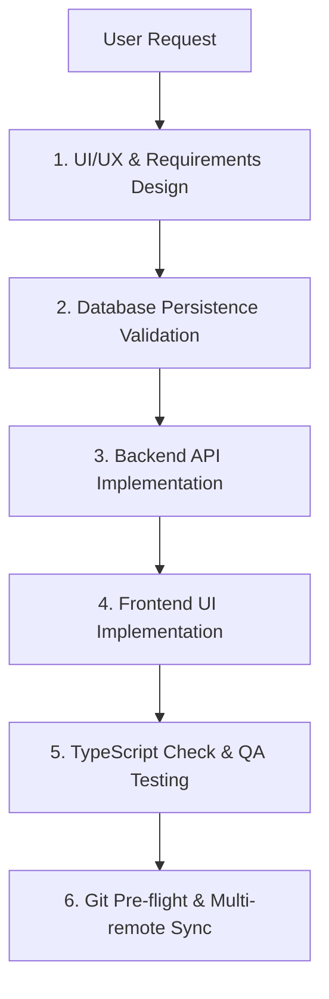

# Fullstack Orchestrator

This skill coordinates specialized sub-agents and enforces fullstack engineering best practices in the Leadsy repository.

## Sub-Agent Roles & Delegation Matrix

1. **Frontend Engineer (`frontend/`)**: Handled via `frontend-engineer` skill.
   - Responsible for Next.js App Router, React client/server components, Zustand state, and API client integration.
   - Governance rule: Must adhere to `frontend/AGENTS.md` and pass `cd frontend && npx tsc --noEmit`.
2. **Backend Engineer (`backend/`)**: Handled via `backend-engineer` skill.
   - Responsible for Laravel 11 routes, controllers, form requests, policies, and Eloquent relationships.
3. **UI/UX Designer**: Handled via `ui-ux-designer` skill.
   - Responsible for design tokens, OKLch colors, responsive layouts, micro-interactions, and alignment with `DESIGN_SYSTEM.md`.
4. **Database Persistence Guard**: Handled via `db-persistence-guard` skill.
   - Verifies schema modifications, guarantees zero data loss, and blocks destructive migrations (`migrate:fresh`, `db:wipe`).
5. **QA & E2E Verifier**: Handled via `qa-e2e-tester` skill.
   - Uses browser subagent, Playwright, or curl/API tests to ensure zero regressions before push.

## Fullstack Workflow Lifecycle



## Mandatory Execution Steps

1. **Pre-flight Check**:
   ```bash
   git fetch origin
   git status
   ```
2. **Execute Phase Breakdown**: Delegate to the corresponding sub-skill based on target directory.
3. **Contract Alignment**: Ensure backend JSON responses match TypeScript interface definitions in `frontend/types/`.
4. **Verification**:
   - Backend syntax check: `cd backend && php -l <file>`
   - Frontend TS check: `cd frontend && npx tsc --noEmit`
