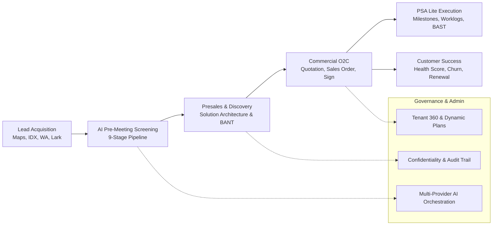
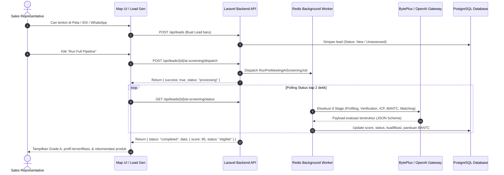
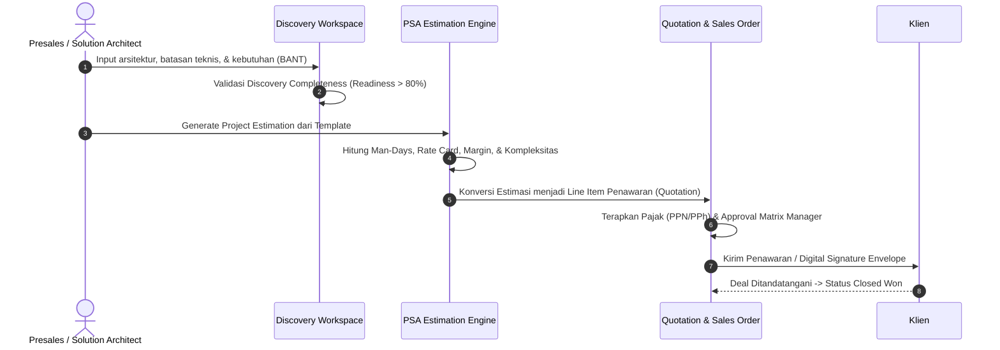
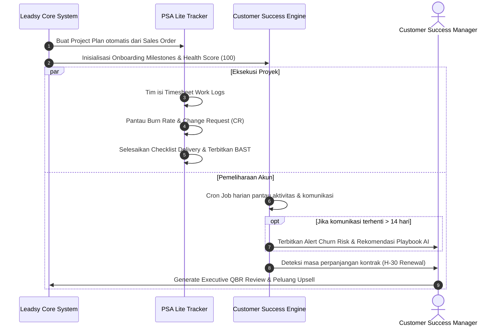
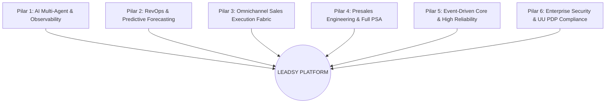

# Laporan Audit Komprehensif Leadsy Platform (v1.31.0)
**Tanggal Audit:** 27 Oktober 2026  
**Status Platform:** Production (K3s Cluster, Multi-Tenant SaaS)  
**Lingkup:** Frontend (Next.js 15), Backend API (Laravel 11 / PHP 8.2), Database (PostgreSQL), Worker/Scheduler (Redis), WhatsApp Gateway, AI Multi-Provider Engine.

---

## 1. Executive Summary & Lanskap Arsitektur

Leadsy adalah platform **B2B Revenue Acceleration & Presales Lifecycle Intelligence** yang mengintegrasikan akuisisi prospek berbasis geospasial, penyaringan kualifikasi AI berlapis (Pre-Meeting AI Screening), tata kelola presales & estimasi proyek (PSA Lite), siklus komersial Order-to-Cash (O2C), hingga retensi dan ekspansi akun pada fase Customer Success.



---

## 2. Inventarisasi Modul & Fitur yang Ada Saat Ini

### A. Akuisisi & Discovery Prospek (Lead Generation)
1. **Geospatial Map & Territory Discovery (`/map`):**
   - Integrasi Google Maps API dengan visualisasi radius interaktif (`<Circle>`).
   - Mode penargetan terencana (*Intentional Territory Pinning Mode*) untuk menghindari pergeseran titik koordinat akibat klik tidak sengaja.
   - Deteksi GPS real-time, preset radius instan (1 km, 3 km, 5 km, 10 km, 25 km), dan penyimpanan teritori sales favorit (*Saved Territories*).
   - Indikator ketersediaan kontak langsung (badge nomor telepon & website), aksi 1-klik Direct WhatsApp (`wa.me`), dan impor batch langsung ke pipeline lead.
2. **IDX Public Companies Explorer (`/lead-generator/idx`):**
   - Pencarian data emiten Bursa Efek Indonesia (IDX) yang terstruktur.
   - Pemetaan otomatis sektor dan industri IDX ke taksonomi kategori bisnis Leadsy.
3. **WhatsApp Conversational Ingestion (`/whatsapp`):**
   - Integrasi ganda: Baileys Node.js Sidecar (port 3002) untuk nomor lokal + Mekari Qontak API untuk akun resmi BSP WhatsApp Business API.
   - Konversi pesan/percakapan masuk menjadi data lead secara langsung (`convertToLead`).
4. **Lark Suite Ecosystem Integration:**
   - Sinkronisasi dua arah (*two-way sync*) antara Leadsy Leads dan Lark Bitable Base dengan pemetaan field kustom.
   - URL Transcript Import: Mengimpor rekaman rapat dari Lark Minutes/Meeting URL dan memicu analisis AI otomatis.

### B. Otomasi AI & Intelligence Engine
1. **Sequential 9-Stage Pre-Meeting AI Screening:**
   - **Stage 1 (Deep Profiling):** Ekstraksi dan standardisasi profil perusahaan melalui *multi-tier scraping*.
   - **Stage 2 (Company Verification):** Verifikasi legalitas perusahaan, domain, dan bukti eksistensi bisnis.
   - **Stage 3 (ICP Matching):** Pencocokan karakteristik lead terhadap *Ideal Customer Profile* (ICP) aktif.
   - **Stage 4 (Deterministic Scoring):** Penilaian skor prospek (0–100) berbasis bobot interaksi dan data kelengkapan.
   - **Stage 5 (Lead AI Analysis):** Analisis peluang, urgensi masalah bisnis, estimasi daya beli, dan pemberian *qualification hint*.
   - **Stage 6 (BANTC Gatekeeper):** Evaluasi kualifikasi Budget, Authority, Needs, Timeline, dan Competency (*Eligible*, *Potential*, *Disqualified*).
   - **Stage 7 (Product Catalog Matching):** Pencocokan produk katalog Leadsy yang paling relevan beserta analisis *product fit*.
   - **Stage 8 (BANTC Question Guide Generation):** Penyusunan panduan pertanyaan discovery spesifik untuk sales saat bertemu prospek.
2. **AI Provider & Model Gateway (`/settings/ai-defaults`):**
   - Dukungan multi-provider: **BytePlus ModelArk** (Doubao 1.5, DeepSeek R1/V3, Skylark 2, Qwen 2.5), **OpenAI**, **Anthropic**, **Gemini**, **Groq**, dan **OpenRouter**.
   - Manajemen prompt template versi JSON Schema, parameter suhu, validasi variabel input, dan fallback routing otomatis.
3. **AI Output Governance & Human-in-the-Loop:**
   - Versioning output AI dengan riwayat perubahan (*Audit Trail*).
   - JSON viewer & manual editor untuk mengoreksi rekomendasi AI sebelum statusnya dibekukan (*frozen/approved*).
   - Deteksi risiko, celah data, dan sinyal peluang melalui widget *AI Attention Highlights*.
4. **Sales Deal Intel & Battle Cards:**
   - *Stalled Deal Detection:* Pemindaian harian transaksi macet (>14 hari atau >7 hari di fase negosiasi) beserta strategi re-engagement.
   - *Competitive Battle Cards:* Pembuatan kartu taktis kelemahan/kelebihan kompetitor dan *objection counters*.

### C. Presales & Solusi Arsitektur
1. **Discovery Workspace (`/leads/[id]` -> AI Intelligence Tab):**
   - Pencatatan konteks bisnis, arsitektur teknis eksisting, kendala infrastruktur, dan batasan implementasi.
   - Mesin kelayakan (*Discovery Completeness & Solution Readiness Score*) dengan persentase 0–100%.
   - Pemisahan ketat antara data terkonfirmasi (*confirmed*), asumsi sales (*assumption*), dan saran mesin (*ai_suggested*).
2. **Katalog Produk & Scrape Auto-Profiling (`/products/[id]`):**
   - Manajemen tier harga SaaS, lisensi, dan batasan paket.
   - Fitur *Scrape & Auto-Profile* berbasis website/PDF menggunakan background queue worker (`GenerateProductMetadataJob`) untuk menghindari HTTP proxy timeout.
   - Perbandingan spesifikasi (*Specification Comparison*) antara website langsung dengan data CRM.

### D. Professional Services Automation (PSA Lite)
1. **Estimasi Presales Proyek (`/professional-services/estimations`):**
   - Penyusunan estimasi kebutuhan Man-Days, rate cards per peran (Project Manager, Solution Architect, Developer, QA), dan matriks kompleksitas.
   - Penguncian versi estimasi (*versioning*) dan persetujuan bertingkat (*Approval Matrix*).
2. **Pelacakan Eksekusi Proyek (`/professional-services/project-plans`):**
   - Pencatatan jam kerja harian (*Work Logs / Timesheets*).
   - Perhitungan varians anggaran aktual vs estimasi (*Burn Rate & Overrun Alerts*).
   - Manajemen *Change Request* (CR) dan Berita Acara Serah Terima (BAST / Project Acceptance) otomatis.

### E. Order-to-Cash (O2C) & Komersial
1. **Manajemen Transaksi (`/leads/[id]` -> Revenue Tab):**
   - Pembuatan Penawaran Harga (*Quotations*) dan Surat Pesanan (*Sales Orders*).
   - Pengaturan perpajakan (PPN 11%, PPh 23) dan kode pemotongan pajak.
   - Pembagian kontribusi peran komersial (*Multi-role Assignment* antara Sales, Presales, dan CSM).
2. **Target & KPI Kinerja Tim (`/settings/targets`):**
   - Pemisahan *Revenue Targets* (berjenjang/cascade khusus tim Sales) dan *KPI Targets* operasional (kuantitas pertemuan, rasio konversi).
   - Dasbor Kinerja Tim 10-blok berbasis kalkulasi database real-time tanpa mock.

### F. Customer Success (CSM Lifecycle)
1. **Customer Health Scoring Engine (`/customer-success`):**
   - Pembobotan 4 faktor: Keaktifan Komunikasi (30%), Progres Onboarding (25%), Sentimen AI (25%), Stabilitas Relasi (20%).
   - Klasifikasi akun: *Thriving*, *Healthy*, *At Risk*, *Critical*.
2. **Post-Won Onboarding:** Otomasi pembuatan milestone implementasi (Kickoff, Setup, Training, UAT, QBR).
3. **Peringatan Dini Churn & Deteksi Perpanjangan Kontrak:** Pemindaian jendela perpanjangan kontrak (<= 30 hari) dan pelacakan survei kepuasan NPS/CSAT.
4. **CS Playbook AI & QBR Generator:** Pembuatan strategi mitigasi churn dan materi presentasi Executive Account Review otomatis.

### G. SaaS Platform Administration (Superadmin Control Plane)
1. **Tenant 360 Console (`/admin/tenants/[id]`):**
   - 7 tab inspeksi: Resource Quotas (Seat, Leads, Disk, AI Budget), User Roster, Siklus Langganan, Modul Entitlements (Feature Flags), Status Integrasi, Audit Trail, dan Danger Zone (Organization Lock & JSON Dump).
2. **Dynamic Plan Packaging (`/admin/plans`):**
   - Konfigurasi paket tier dinamis (kuota database, batas token AI, biaya kursi tambahan) dengan kalkulasi live MRR / ARR.
3. **Keamanan & Kepatuhan:**
   - Dasbor Matriks Kerahasiaan Data (10-blok Confidentiality Engine).
   - Log audit menyeluruh dan pencegahan penghapusan akun berstatus aktif.

---

## 3. Alur Kerja End-to-End (Functional Workflows)

### Alur 1: Dari Akuisisi Prospek Menuju Kualifikasi AI


### Alur 2: Dari Presales Discovery ke Estimasi & Penawaran Komersial


### Alur 3: Pasca-Closing: Eksekusi PSA Lite & Customer Success


---

## 4. Temuan Audit Kualitas & Potensi Bottleneck

| Area | Status Saat Ini | Dampak / Risiko | Tingkat Urgensi |
| :--- | :--- | :--- | :--- |
| **Komunikasi Asynchronous** | Menggunakan client-side HTTP Polling (interval 2 detik) | Beban HTTP request tinggi pada server; rentan gateway timeout jika koneksi socket browser terputus saat pod restart | **Tinggi (High)** |
| **Manajemen Kegagalan Antrean (Dead-Letter Queue)** | Job AI tersimpan di Redis cache; jika worker crash, status bisa terjebak di `processing` | Sales harus memicu ulang secara manual jika antrean gagal tanpa penjelasan error yang terlihat di UI admin | **Sedang (Medium)** |
| **Konektivitas WhatsApp Sidecar** | Session Baileys tersimpan di disk lokal container Node.js | Jika container restart tanpa persistent storage volume yang tepat, QR code perlu dipindai ulang | **Sedang (Medium)** |
| **Jembatan Estimasi PSA ke Quotation** | Pembuatan Quotation masih membutuhkan salin-tempel manual dari data Man-Days estimasi | Potensi kesalahan input angka atau deskripsi layanan saat transisi dari presales ke sales | **Sedang (Medium)** |
| **Deployment Rolling Pod** | Standar Kubernetes rolling update tanpa `preStop` sleep hook pada ingress | Request browser yang bersamaan dengan rolling update pod menerima respons 502/504 sementara | **Rendah (Low)** |

---

## 5. Roadmap Strategis & Rekomendasi Improvement Komprehensif (6 Pilar Transformasi Enterprise)

Berdasarkan audit arsitektur menyeluruh terhadap Leadsy v1.31.0, platform ini telah memiliki fondasi data dan integrasi hulu-ke-hilir yang sangat kokoh. Namun, untuk bertransformasi dari sekadar CRM internal menjadi **Enterprise-Grade Revenue & Presales Operating System**, berikut adalah roadmap perbaikan komprehensif yang dirancang ke dalam **6 Pilar Strategis**:



---

### PILAR 1: AI Engine & Intelligence Maturity (Dari Scripted Pipeline ke Autonomous Multi-Agent)

1. **Autonomous Prospecting Agent (AI Sales Development Representative - AI SDR):**
   - **Konsep:** Bukan hanya menunggu sales menekan tombol "Run Full Pipeline", sistem memiliki background agent proaktif yang memindai target industri dan teritori secara otomatis.
   - **Kapabilitas:** Memantau sinyal niat beli (*Buying Intent Signals*) seperti pengumuman pendanaan startup, pembukaan tender e-procurement pemerintah/BUMN, ekspansi pabrik baru di kawasan industri, atau lowongan kerja strategis di LinkedIn/Jobstreet, lalu otomatis menginisiasi enrichment dan scoring prospek ke dalam pipeline.
2. **Semantic Caching & LLM Cost Optimizer:**
   - **Tantangan:** Setiap kali URL/perusahaan dianalisis ulang, sistem melakukan panggilan API penuh ke BytePlus/OpenAI, menimbulkan biaya token dan latensi tinggi.
   - **Solusi:** Terapkan **Semantic Caching** menggunakan Redis Vector Search atau Hash embeddings. Jika profil perusahaan atau domain yang sama sudah pernah di-scrape dalam kurun waktu 14 hari, gunakan data cache vektor yang sudah diverifikasi, memotong latensi hingga 90% dan menghemat biaya API AI.
3. **LLM Observability & Tracing Engine (Langfuse / OpenTelemetry Integration):**
   - Tambahkan dashboard audit latensi token, prompt version performance, dan error rate per provider di `/admin/ai-accounting`.
   - Implementasikan **LLM-as-a-Judge Eval Harness** untuk secara berkala menguji apakah model Doubao, DeepSeek, atau OpenAI menghasilkan skor kualifikasi yang konsisten dan mematuhi schema JSON tanpa halusinasi.
4. **Interactive In-Context Sales Copilot Drawer:**
   - Di halaman detail lead (`/leads/[id]`), hadirkan *Sidecar Copilot Drawer*. Sales rep dapat berdialog interaktif dengan asisten AI yang memegang seluruh *in-memory context* lead (transkrip rapat Lark, riwayat chat WhatsApp, BANTC, dan katalog produk) untuk menyusun strategi negosiasi harga atau menyiapkan materi presentasi khusus.

---

### PILAR 2: Revenue Operations (RevOps) & Predictive Forecasting

1. **Predictive Deal Slippage & Win Probability Engine:**
   - Bangun model probabilitas kemenangan (*Win Probability Score*, 0–100%) berbasis machine learning / regresi probabilistik.
   - Variabel evaluasi: Kecepatan transisi funnel (*deal velocity*), frekuensi interaksi komunikasi (WhatsApp/Meeting), kelengkapan skor BANTC, dan selisih nilai proposal terhadap rata-rata pasar.
   - Peringatan dini otomatis jika deal diprediksi "Meleset dari target kuartal ini" (*Slippage Alert*).
2. **Dynamic Pipeline Health & Cohort Matrix Dashboard:**
   - Dashboard analitik baru di `/analytics/pipeline-cohorts` yang memetakan efektivitas kanal akuisisi secara real-time:
     - CAC (*Customer Acquisition Cost*) estimasi per sumber (Maps vs IDX vs WA vs Lark).
     - Durasi siklus penjualan rata-rata (*Sales Cycle Length*) dari Lead Baru hingga Closed Won.
     - Rasio kebocoran pipeline (*Funnel Drop-off Rate*) di tiap transisi tahapan.
3. **Advanced Revenue Recognition & Multi-Period Deferred Revenue:**
   - Standar pengakuan pendapatan bertahap (PSAK 72 / IFRS 15) untuk kontrak tahunan atau proyek multi-tahap (misal: 30% Down Payment saat SPK, 50% saat UAT, 20% saat BAST Final), terintegrasi ke modul Quotation & Sales Order.

---

### PILAR 3: Omnichannel Sales Execution & Engagement Fabric

1. **Multi-Touch Sales Cadence / Sequence Engine:**
   - Mesin automasi urutan aktivitas prospek (*Sales Sequences*):
     - **Hari 1:** Kirim pesan perkenalan WhatsApp otomatis berbasis template yang dipersonalisasi AI.
     - **Hari 3:** Jika tidak ada balasan, buat tugas telepon bagi sales rep dengan panduan BANTC Question Guide.
     - **Hari 5:** Kirim profil perusahaan & portofolio via Email resmi.
     - **Hari 8:** Notifikasi reminder follow-up di Lark / WhatsApp.
2. **Unified Omnichannel Communication Inbox:**
   - Tampilan antarmuka satu pintu terpadu (`/inbox`) yang menyatukan seluruh riwayat percakapan WhatsApp (nomor lokal Baileys + BSP Qontak), mention Lark, dan email sales dalam satu *thread timeline* per pelanggan.
   - Fitur *Collaborative Inbox*: Sales Manager dapat memberikan catatan internal (*Internal Mentions*) di samping percakapan klien tanpa terlihat oleh klien.
3. **Offline-First Field Sales Operations (Mobile PWA & Sync Engine):**
   - Sales lapangan yang mengunjungi kawasan industri sering mengalami *dead-zone signal*.
   - Tingkatkan arsitektur mobile/PWA menjadi **Offline-First dengan IndexedDB / SQLite Sync**. Sales dapat mencatat hasil kunjungan, mengambil foto geotagged lokasi kantor prospek, dan menyimpan formulir discovery secara offline, yang otomatis tersinkronisasi saat perangkat kembali terhubung internet.

---

### PILAR 4: Presales Engineering & PSA Enterprise Expansion

1. **1-Klik Konverter Estimasi PSA ke Quotation Komersial:**
   - Tombol instan di halaman estimasi presales untuk mengonversi komponen Man-Days teknis menjadi draft dokumen penawaran harga (*Quotation*), mencegah ketidaksinkronan antara scope of work (SOW) teknis dan nominal invoice.
2. **Resource Capacity & Skill Matrix Management:**
   - Visualisasi ketersediaan sumber daya (*Resource Heatmap / Gantt Matrix*): Melacak apakah Solution Architect, Tech Lead, atau Developer sedang *overallocated* atau memiliki *bench capacity* untuk mengambil proyek baru.
   - *Skill Tagging:* Pencocokan otomatis proyek klien dengan tim presales yang memiliki kompetensi/sertifikasi terkait (misal: AWS Certified, Kubernetes, Cybersecurity).
3. **Automated Statement of Work (SOW) & BAST Document Assembler:**
   - Otomasi pembentukan berkas SOW resmi dan dokumen BAST dalam format PDF/Docx berstandar hukum perusahaan, lengkap dengan lampiran ruang lingkup (*Scope of Work*), deliverable checklist, timeline milestone, dan klausul garansi.
4. **Integrasi Legal Digital Signature Resmi Indonesia:**
   - Menghubungkan modul *Digital Signature Envelopes* ke penyedia Penyelenggara Sertifikasi Elektronik (PSrE) berizin Kominfo RI seperti **PrivyID**, **Peruri Code**, atau **VIDA**, memberikan kekuatan hukum pembuktian penuh pada kontrak digital.

---

### PILAR 5: Arsitektur Sistem, Kinerja & Event-Driven Backbone

1. **Transisi Polling ke Server-Sent Events (SSE) / WebSockets:**
   - Mengganti seluruh polling periodik (`apiFetch` tiap 2 detik) pada AI Screening, Scrape Produk, dan Sinkronisasi Lark dengan koneksi real-time stream (SSE via Laravel atau Pusher/WebSockets).
   - Menghilangkan beban ribuan request polling ke ingress dan mencegah timeout proxy reverse 502/504 secara permanen.
2. **Event-Driven Architecture (EDA) dengan Domain Event Bus:**
   - Terapkan *Domain Events* (misal: `LeadClosedWon`, `EstimationApproved`, `DealStalledDetected`) menggunakan Redis Streams / Event Bus terpusat.
   - Menghilangkan *tight-coupling* antar controller: saat deal closed-won, listener PSA, Onboarding CSM, Revenue Target, dan Invoice generation akan dieksekusi secara asinkron dan independen.
3. **Zero-Downtime Deployment Pod Hardening:**
   - Tambahkan `preStop` lifecycle hook (`sleep 10s`) dan konfigurasi `readinessProbe` / `livenessProbe` ketat pada manifest Kubernetes K3s (`k8s/leadsy-prod-frontend.yaml` dan `backend`).
   - Memastikan Nginx reverse proxy mencabut trafik dari pod lama sebelum container dimatikan, sehingga rilis kode baru bebas dari jeda *"The server is not responding right now"*.
4. **Database Table Partitioning & Archival:**
   - Terapkan skema partisi bulanan (*Range Partitioning*) pada tabel dengan pertumbuhan data tinggi di PostgreSQL: `audit_logs`, `ai_usage_logs`, `ai_requests`, dan `whatsapp_messages`.
   - Menjaga kecepatan index query database operasional tetap sub-milidetik meski data riwayat mencapai jutaan baris.

---

### PILAR 6: Enterprise Governance, Privasi Data (UU PDP) & Kepatuhan

1. **Kepatuhan Regulasi UU Pelindungan Data Pribadi (UU PDP):**
   - **PII Sanitizer & Data Masking Gateway:** Sebelum data lead (NIK, rekening bank, nomor ponsel pribadi direktur, nominal finansial internal) dikirim ke model LLM publik pihak ketiga (BytePlus/OpenAI/Gemini), sistem otomatis menyamarkan (*anonymize/mask*) data sensitif tersebut dan memulihkannya kembali (*de-mask*) saat output diterima.
   - **Right to be Forgotten (Hak Penghapusan Data):** Mekanisme audit-compliant untuk menghapus atau menganonimkan data prospek secara permanen atas permintaan resmi klien tanpa merusak integritas relasional laporan keuangan.
2. **Enterprise SSO & Identity Federation (SAML 2.0 / OIDC):**
   - Perluas autentikasi SSO di luar Lark: Tambahkan integrasi resmi ke **Microsoft Entra ID (Azure AD)**, **Okta**, dan **Google Workspace SAML** untuk login tim korporat skala besar.
3. **Granular Attribute-Based Access Control (ABAC) & Data Silos:**
   - Pengaturan isolasi visibilitas data berbasis wilayah cabang (*Regional Data Boundary*). Sales di regional Jawa Timur tidak dapat melihat atau mengunduh basis data prospek di regional Jabodetabek kecuali diberi hak lintas wilayah oleh Direktur Penjualan.
4. **SaaS Multi-Tenant Database Separation Option (Hybrid Single-Tenant):**
   - Bagi klien korporat dengan regulasi kepatuhan ketat (Perbankan/Fintech/Instansi Pemerintah), sediakan opsi arsitektur *Dedicated Database Schema / Separate Database Connection* per tenant melalui konfigurasi Tenant 360, terpisah dari pool shared database tenant UMKM.

---

## 6. Matriks Prioritas Eksekusi Roadmap (Impact vs. Effort)

```
        TINGGI  │ [Pilar 1.2: Semantic Cache]     │ [Pilar 1.1: Autonomous AI SDR]
                │ [Pilar 5.1: Real-time SSE]       │ [Pilar 3.1: Omnichannel Cadence]
                │ [Pilar 4.1: Est-to-Quote 1-Click]│ [Pilar 2.1: Predictive Deal Slippage]
   BUSINESS     │                                  │
    IMPACT      ├──────────────────────────────────┼──────────────────────────────────────
                │ [Pilar 5.3: Zero-Downtime Pods]  │ [Pilar 4.2: Resource Gantt Matrix]
                │ [Pilar 6.1: PII Masking LLM]     │ [Pilar 3.3: Offline-First Field PWA]
                │ [Pilar 1.3: Queue/DLQ Inspector] │ [Pilar 6.4: Hybrid Dedicated DB]
        RENDAH  │                                  │
                └──────────────────────────────────┴──────────────────────────────────────
                                 RENDAH                          TINGGI
                                        DEVELOPMENT EFFORT
```

---

## 7. Rekomendasi Langkah Aksi Segera (Immediate Action Plan - 3 Sprint Ke Depan)

1. **Sprint 1 (Reliabilitas & Kestabilan AI):**
   - Implementasi **Server-Sent Events (SSE)** untuk AI Screening & Profiling (menghilangkan timeout reverse proxy).
   - Penambahan `preStop` hook pada K3s pod deployment untuk memastikan zero-downtime deployment.
   - Penerapan **PII Data Masking** pada prompt AI agar aman dari kebocoran data rahasia klien ke LLM pihak ketiga.
2. **Sprint 2 (Presales & RevOps Velocity):**
   - Pembuatan jembatan **1-Klik Konversi Estimasi PSA ke Quotation**.
   - Integrasi **Semantic Caching** pada Redis untuk scraping website dan profil perusahaan.
   - Pembangunan konsol **Queue & DLQ Inspector** di menu Admin.
3. **Sprint 3 (Autonomous Sales & Engagement):**
   - Pembangunan **Omnichannel Cadence Engine** (tahapan outreach terorkestrasi WA & Lark).
   - Pengaktifan algoritma **Predictive Deal Slippage Alert** pada dashboard sales.

