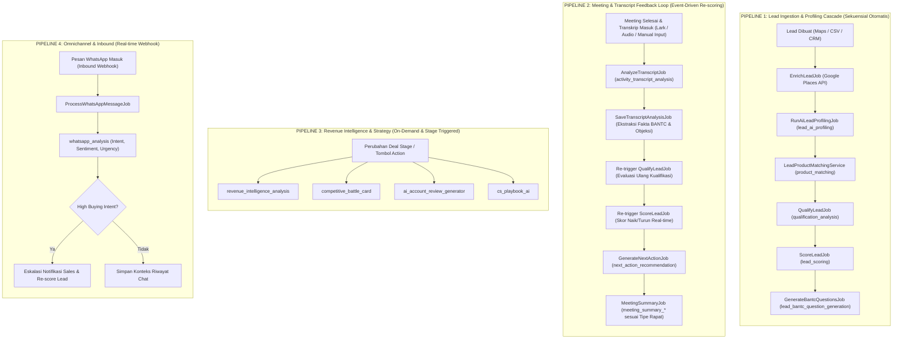
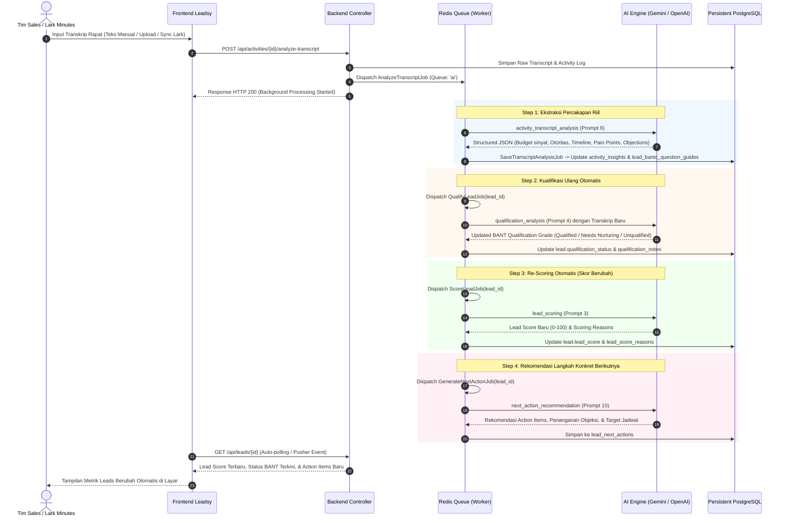

# Leadsy Enterprise AI Architecture: End-to-End Execution Flows, Triggers & Dependency Matrix

**Versi Dokumen:** 1.0.0  
**Tanggal:** 7 November 2026  
**Target Komponen:** Backend Laravel (`AIPromptTemplateService`, Queue Workers, Event Listeners) & Frontend Next.js  
**Total Kemampuan AI Terdaftar:** 35 Registered Prompt Templates & Intelligence Services  

---

## 1. Executive Summary

Platform **Leadsy** mengintegrasikan 35 kapabilitas Artificial Intelligence (AI) yang dirancang untuk mengotomatisasi siklus hidup B2B Revenue Intelligence — mulai dari penemuan prospek (*ingestion & discovery*), kualifikasi berbasis data lapangan (*event-driven meeting feedback loop*), hingga strategi penutupan kesepakatan (*revenue intelligence & account retention*).

Arsitektur AI Leadsy **bukanlah sistem monolitik satu langkah**, melainkan **State Machine berbasis Event-Driven & Queue Asynchronous**. Setiap fungsi AI memiliki:
1. **Pemicu Khusus (*Trigger*)**: Otomatis melalui Pipeline Database / Ingestion, Webhook Omnichannel, Event Listener Meeting, Scheduler Cron, atau Tombol On-Demand oleh Tim Sales.
2. **Ketergantungan Data (*Dependency Chain*)**: Sebagian besar AI berjalan **sekuensial bertingkat (*sequential cascade*)**, di mana output AI tahap awal menjadi prompt context bagi AI tahap berikutnya (misal: *Profiling* $\rightarrow$ *Product Matching* $\rightarrow$ *Qualification* $\rightarrow$ *Scoring* $\rightarrow$ *BANTC Guide*).
3. **Mekanisme Umpan Balik Lapangan (*Feedback Loop*)**: Ketika tim sales memasukkan transkrip rapat (manual teks, audio file, atau sinkronisasi Lark Minutes), sistem menjalankan pipeline re-evaluasi secara otomatis untuk memperbarui status kualifikasi dan skor leads.

---

## 2. Arsitektur 4 Pipeline Utama

---

## 3. Deep Dive: Meeting Transcript Feedback Loop (Kasus Spesifik)

Pertanyaan utama operasional:  
> *"Apakah setelah meeting selesai dan transkrip di-input, AI akan bekerja kembali untuk menilai kualitas leads?"*

**Jawaban: YA, ini adalah arsitektur inti dari Leadsy Event-Driven Feedback Loop.**

Berikut adalah tahapan sekuensial yang berjalan ketika data transkrip dimasukkan:

---

## 4. Matriks Lengkap 35 Fitur AI Leadsy (`AIPromptTemplateService`)

Berikut adalah katalog lengkap seluruh 35 template prompt yang terdaftar secara resmi di `app/Services/Ai/AIPromptTemplateService.php`, mencakup sumber pemicu, dependensi input, serta model eksekusinya:

| # | Feature Key | Nama Fitur | Pemicu (*Trigger*) | Dependensi Input | Output Target | Model Eksekusi |
|---|---|---|---|---|---|---|
| 1 | `lead_ai_profiling` | Corporate Profiling | Lead Creation / Ingestion Maps | Google Places Info, Website URL, Nama Perusahaan | `lead_profiles` (Industri, Model Bisnis, Target Pasar, Ukuran Perusahaan) | **Sekuensial (Tahap 1)** |
| 2 | `lead_analysis` | Deep Lead Analysis | Tombol "Analyze Lead" / Profiling Done | Hasil Profiling, Data Kontak, Alamat | `lead_analyses` (SWOT, Risiko, Peluang Kerjasama) | Sekuensial pasca Profiling |
| 3 | `lead_scoring` | Predictive Lead Score | Pasca Profiling / Pasca Transkrip Meeting | Profiling, Kualifikasi BANT, Riwayat Interaksi | `lead.lead_score` (0-100), `score_reasons` | **Sekuensial Berulang (*Cascaded*)** |
| 4 | `qualification_analysis` | BANT Qualification | Pasca Product Fit / Pasca Transkrip Meeting | Profil Produk Cocok, Transkrip Percakapan | `lead.qualification_status`, BANT Assessment | **Sekuensial Berulang (*Cascaded*)** |
| 5 | `product_matching` | Product-Lead Fit Matrix | Pasca Profiling Selesai | `lead_profiles`, Katalog Produk Aktif Perusahaan | `lead_product_matches` (Skor Kesesuaian %, Alasan Fit) | **Sekuensial (Tahap 2)** |
| 6 | `product_understanding` | Knowledge Base Analysis | Admin Input / Edit Produk Baru | Dokumen Produk, Brosur, Deskripsi Teknis | `product.ai_metadata` (Value Proposition, Target Persona) | Independen (On-Demand) |
| 7 | `icp_generation` | Ideal Customer Profile | Konfigurasi Target Pasar Baru | Daftar Klien Closing Tertinggi, Deskripsi Produk | `icp_profiles` (Karakteristik ICP Ideal) | Independen (Analitikal) |
| 8 | `meeting_evaluation` | Meeting Effectiveness Score | Activity Meeting Ditutup | Catatan Meeting, Durasi, Partisipan | `activity.meeting_score`, Evaluasi Kualitas Rapat | Independen per Meeting |
| 9 | `activity_transcript_analysis` | Transkrip Meeting Analyzer | Input / Upload / Sync Transkrip | Raw Text Transkrip Percakapan | Ekstraksi Fakta BANTC, Objeksi Klien, Komitmen | **Pemicu Utama Feedback Loop** |
| 10 | `next_action_recommendation` | Next Best Action Engine | Pasca Transkrip / Stage Change | Kualifikasi Terkini, Objeksi, Riwayat Aktivitas | `lead_next_actions` (Panduan Taktis Sales Berikutnya) | Sekuensial pasca Transkrip |
| 11 | `recommendation_engine` | Strategic Lead Strategy | Tombol "Get Strategy" / Review Bulanan | Seluruh Riwayat Interaksi & Profiling | Rekomendasi Makro Penjualan | Independen (On-Demand) |
| 12 | `pre_meeting_brief_generation` | Pre-Meeting Briefing Sheet | Jadwal Meeting Dibuat (D-1 atau H-1 Jam) | Profiling Lead, Riwayat Objeksi, LinkedIn Profil | Lembar Persiapan Meeting untuk Sales Representative | Independen / Jadwal |
| 13 | `summary_generation` | General Activity Summary | Tiap Log Aktivitas Tersimpan | Teks Catatan Sales Lapangan | Rangkuman Cepat 2 Paragraf | Independen |
| 14 | `revenue_intelligence_analysis` | Pipeline Risk & Health | Deal Stage Mandek (>14 Hari) / Manual | Nilai Deal, Riwayat Stage, Kecepatan Respon | Skor Probabilitas Closing & Deteksi Risiko Red Flag | Independen / Scheduler |
| 15 | `whatsapp_analysis` | Inbound Chat Sentiment & Intent | Webhook WhatsApp Masuk | Teks Pesan Masuk WhatsApp | Deteksi Sentimen, Kesiapan Beli, Saran Balasan Cepat | Real-time Webhook |
| 16 | `product_metadata_generation` | Auto-Tagging Produk | Katalog Produk Diperbarui | Spesifikasi Produk | Tag Kategori, Target Industri Otomatis | Independen |
| 17 | `geo_product_fit_analysis` | Wilayah & Density Product Fit | Analisis Peta Prospek | Koordinat Lead, Kluster Industri Wilayah | Peringkat Produk Terlaris per Radius Wilayah | Independen (GIS Analytical) |
| 18 | `product_question_generation` | Pitching Discovery Questions | Produk Dipasangkan ke Lead | Deskripsi Produk Terpilih & Profil Lead | Daftar Pertanyaan Pemantik Kebutuhan (*Discovery*) | Sekuensial pasca Matching |
| 19 | `lead_bantc_question_generation` | Dynamic BANTC Playbook | Lead Pertama Kali Diprofiling | Profil Industri & Pain Point Umum | 5 Panduan Pertanyaan Validasi Lapangan Khusus | **Sekuensial (Tahap Akhir Ingest)** |
| 20 | `lead_contact_google_search_keyword` | Decision Maker Finder | Kontak PIC Kosong pada Lead | Nama PT, Lokasi Cabang, Industri | Keyword Pencarian Google & LinkedIn D-Level | Independen (Enrichment Tool) |
| 21 | `dashboard_ai_insight` | Executive Performance Insight | Tiap Pagi 07:00 WIB (Cron) | Rekapitulasi Pipeline Mingguan, Konversi Tim | Rangkuman AI Eksekutif di Dashboard Utama | Repetitif (Scheduled Cron) |
| 22 | `customer_journey_story` | Account Audit Storyline | Tombol "Export Account Journey" | Seluruh Timeline dari Lead s/d Closing | Narasi Kronologis Perjalanan Klien | On-Demand Report |
| 23 | `meeting_summary_general_prompt` | General Meeting Minutes | Meeting Status = Done | Transkrip Rapat Umum | Notulen Terstruktur & Action Points | On-Demand / Post-Meeting |
| 24 | `meeting_summary_discovery_prompt` | Discovery Meeting Minutes | Rapat Tipe "Discovery" Selesai | Transkrip Rapat Tahap Awal | Pemetaan Pain Points & Verifikasi Kebutuhan | Khusus Stage Discovery |
| 25 | `meeting_summary_demo_prompt` | Product Demo Minutes | Rapat Tipe "Demo" Selesai | Transkrip Demonstrasi Solusi | Respon Fitur, Request Custom, Feedback UX | Khusus Stage Demo |
| 26 | `meeting_summary_follow_up_prompt` | Follow-up Call Minutes | Rapat Tipe "Follow-up" Selesai | Transkrip Evaluasi Proposal | Negosiasi Harga & Klarifikasi Keraguan | Khusus Stage Follow-up |
| 27 | `meeting_summary_proposal_discussion_prompt` | Proposal Discussion Minutes | Rapat Tipe "Proposal" Selesai | Transkrip Pembahasan Komersial | Catatan Penyesuaian Ruang Lingkup & SLA | Khusus Stage Proposal |
| 28 | `meeting_summary_closing_discussion_prompt` | Closing Negotiation Minutes | Rapat Tipe "Closing" Selesai | Transkrip Negosiasi Final | Keputusan Legal, Term of Payment, Tanggal TTD | Khusus Stage Closing |
| 29 | `meeting_summary_handover_csm_prompt` | Post-Sales Handover Minutes | Deal Won $\rightarrow$ Transisi CSM | Transkrip Rapat Kick-off / Handover | Scope of Work, Komitmen Khusus, Ekspektasi Klien | Khusus Transisi CSM |
| 30 | `competitive_battle_card` | Battle Card Generator | Pesaing Disebut di Transkrip / Manual | Nama Kompetitor yang Disebut Klien | Argumen Diferensiasi, Komparasi Harga & Fitur | Event-Driven / On-Demand |
| 31 | `ai_account_review_generator` | Quarterly Account Review (QBR) | Jadwal QBR / Deal Nilai Tinggi | Riwayat Support, Penggunaan Produk, NPS | Presentasi Evaluasi Akun Klien | On-Demand |
| 32 | `cs_playbook_ai` | Customer Success Retention | Lead Status = Won / Active Client | Profil Klien, Keluhan Terakhir, Tren Penggunaan | Rencana Retensi & Rekomendasi Cross-selling | On-Demand CSM |
| 33 | `ps_task_breakdown_generation` | Professional Service WBS | Proposal Disetujui (Deal Closed) | Scope of Work, SLA, Transkrip Teknis | Rincian Work Breakdown Structure (WBS) & Sprint | On-Demand Delivery Team |
| 34 | `product_specification_comparison` | Perbandingan Spek Kompetitor | Sales Meminta Komparasi Produk | 2 atau Lebih Spesifikasi Teknis Produk | Tabel Komparasi Apple-to-Apple & Selling Point | On-Demand Sales Tool |
| 35 | `industry_news_extraction` | Industry Signal & Trend | Cron Tiap Senin 06:00 WIB | Keyword Industri dari Akun Prospek Utama | Ekstraksi Berita Tren Regulasi & Peluang Bisnis | Repetitif (Weekly Cron) |

---

## 5. Hubungan Dependensi & Alur Sekuensial (Sequential vs Independent)

Sistem AI Leadsy mengadopsi prinsip desain hibrida:

### A. Rantai Sekuensial Kritis (*Strict Sequential Pipeline*)
Fungsi-fungsi ini **wajib menunggu hasil fungsi sebelumnya** karena membutuhkan artefak terstruktur sebagai input konteks:
1. `lead_ai_profiling` (Wajib pertama untuk memahami bidang usaha & industri prospek).
2. `product_matching` (Membutuhkan profil industri dari AI #1 untuk menghitung kecocokan katalog produk).
3. `qualification_analysis` (Membutuhkan produk yang cocok dari AI #5 untuk menilai urgensi dan anggaran prospek).
4. `lead_scoring` (Membutuhkan status kualifikasi dari AI #4 untuk menghitung skor numerik 0-100 secara obyektif).
5. `lead_bantc_question_generation` (Membutuhkan kelemahan/celah kualifikasi dari AI #4 untuk membuat panduan pertanyaan lapangan).

### B. Loop Rekursif Berbasis Event Transkrip (*Event-Driven Loop*)
Ketika ada masukan baru (misal: transkrip rapat baru diunggah oleh sales setelah kembali dari kantor klien):
1. `activity_transcript_analysis` dijalankan pertama kali untuk memecah fakta baru (apakah klien menyetujui budget? siapa pengambil keputusan sesungguhnya?).
2. Fakta baru ini meng-update database BANTC.
3. Update tersebut **secara otomatis menembakkan (*cascades*)** `qualification_analysis` dan `lead_scoring` ulang.
4. Skor lead yang tadinya 45 dapat melonjak menjadi 88 (atau sebaliknya turun menjadi 20 jika klien menyatakan tidak ada alokasi anggaran tahun ini).
5. Secara otomatis memicu `next_action_recommendation` baru untuk tim sales.

### C. Fungsi Independen / On-Demand (*Loose Decoupled Services*)
Fungsi-fungsi berikut **tidak mengunci pipeline utama** dan dapat dipanggil kapan saja sesuai kebutuhan user:
- `competitive_battle_card` (Hanya dipanggil jika sales membutuhkan amunisi menghadapi kompetitor tertentu).
- `pre_meeting_brief_generation` (Dipanggil saat sales bersiap 1 jam sebelum meeting).
- `ps_task_breakdown_generation` (Hanya dipanggil setelah deal resmi dimenangkan).
- `whatsapp_analysis` (Dipicu oleh webhook pesan masuk secara terisolasi).

---

## 6. Repetitive & Scheduled Background AI Tasks

Tabel tugas berkala (*cron/scheduler*) yang berjalan di Leadsy Worker:

| Frekuensi | Waktu Eksekusi | Job / Perintah | Kapabilitas AI Terlibat | Deskripsi |
|---|---|---|---|---|
| **Harian** | 07:00 WIB | `php artisan leadsy:daily-ai-insights` | `dashboard_ai_insight` (#21) | Memindai pergerakan pipeline 24 jam terakhir dan menyusun briefing pagi untuk Sales Manager di dashboard. |
| **Harian** | 08:00 WIB | `php artisan leadsy:stale-leads-scan` | `revenue_intelligence_analysis` (#14) | Mendeteksi deal bernilai > Rp 50 Juta yang tidak mengalami aktivitas lebih dari 14 hari, lalu menandai risiko stall. |
| **Mingguan** | Senin 06:00 WIB | `php artisan leadsy:extract-industry-news` | `industry_news_extraction` (#35) | Mengumpulkan tren dan regulasi terbaru seputar industri target klien aktif untuk bahan pembuka percakapan sales. |
| **D-1 Meeting** | 18:00 WIB | `php artisan leadsy:generate-meeting-briefs` | `pre_meeting_brief_generation` (#12) | Menghasilkan ringkasan persiapan meeting untuk semua jadwal yang terdaftar pada keesokan harinya. |

---

## 7. Reliabilitas, Isolasi Antrian & Mekanisme Failover

Untuk menjamin keandalan saat beban pemrosesan tinggi:
1. **Pemisahan Antrian Worker (*Queue Isolation*)**:
   - `queue: default` $\rightarrow$ Operasi cepat database, notifikasi email.
   - `queue: ai` $\rightarrow$ Pipeline utama profiling, scoring, dan kualifikasi (timeout: 120 detik).
   - `queue: ai-heavy` $\rightarrow$ Pemrosesan transkrip rapat panjang, extraksi berkas audio, dan pembuatan WBS kompleks (timeout: 300 detik).
2. **Toleransi Kegagalan Provider AI (*Multi-Model Fallback*)**:
   - Primary Provider: **Google Gemini 1.5 Pro / Flash** (Kecepatan tinggi, jendela konteks 1M token untuk transkrip rapat utuh).
   - Secondary Fallback: **OpenAI GPT-4o / GPT-4o-mini** (Diaktifkan otomatis oleh `AIPromptTemplateService` jika terjadi rate-limit HTTP 429 atau service unavailable HTTP 503 dari Google).
3. **Idempotensi & Non-Destructive Update**:
   - Setiap eksekusi ulang AI pada lead yang sama tidak menghapus data historis percakapan, melainkan membuat versi baru (*audit trail*) dan memperbarui kolom status terkini secara aman.

