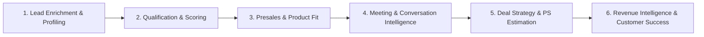

# Arsitektur & Katalog Komprehensif Seluruh Fitur AI Leadsy

Dokumen ini merupakan panduan resmi (*Single Source of Truth*) mengenai arsitektur, peran, alur kerja (*workflow*), tujuan bisnis (*business objective*), kontrak input/output, serta penempatan siklus (*lifecycle positioning*) dari **seluruh fitur AI** yang beroperasi di dalam ekosistem CRM B2B **Leadsy**.

---

## 1. Peta Siklus Hidup Penjualan B2B (Lifecycle Positioning Map)

Fitur AI di Leadsy dirancang untuk mendampingi seluruh tahapan interaksi bisnis dari *top-of-funnel* hingga *post-sales expansion*, terbagi ke dalam **6 Domain Strategis**:



---

## 2. Rincian Fitur Berdasarkan Domain

---

### Domain 1: Lead Ingestion, Profiling & Firmographic Enrichment

Tujuan utama domain ini adalah mengubah data kontak/perusahaan yang minim (misal hanya nama PT dan website) menjadi profil firmografis yang kaya, terverifikasi fakta, dan siap diproses oleh tim sales.

#### 1. `lead_ai_profiling` (Lead AI Company Profiling & Autonomous Web Research)
* **Positioning**: *Top of Funnel / Ingestion / On-demand Profiling*.
* **Tujuan**: Mengumpulkan intelijen bisnis mendalam tentang suatu perusahaan B2B menggunakan kombinasi data internal CRM dan penelusuran web aktif (*real-time web search crawler* via DuckDuckGo/Tavily + direct homepage scraping).
* **Workflow**:
  1. Pengguna membuka Lead Profile lalu mengklik "AI Profile" atau dipicu otomatis saat import.
  2. Sistem menjalankan `UniversalWebResearchService` untuk mencari website resmi, ringkasan bisnis, dan berita industri.
  3. Mengambil konten halaman web resmi (*page fetcher* dengan proteksi SSRF).
  4. Prompt dirakit bersama data produk internal dan dikirim ke model AI via `AIRoutingService`.
  5. Hasil disimpan ke kolom profil lead dan riwayat audit `lead_analysis_logs`.
* **Input**: Nama perusahaan, website, industri awal, kontak, katalog produk.
* **Output**: JSON terstruktur berisi:
  - `company_summary`: Gambaran umum bisnis dan operasional.
  - `core_business`: Model bisnis (B2B/B2C, produk/jasa utama).
  - `target_market`: Segmen pasar yang disasar perusahaan tersebut.
  - `estimated_size`: Estimasi skala perusahaan (SMB, Mid-Market, Enterprise).
  - `industry`: Klasifikasi industri.
  - `strategic_initiatives`: Inisiatif atau ekspansi terkini.
  - `potential_pain_points`: Masalah operasional yang berpotensi diselesaikan produk Leadsy.
  - `recommended_product_ids`: Rekomendasi produk CRM yang paling relevan.

#### 2. `lead_company_enrichment` & `lead_enrichment` (Lead Firmographic Enrichment)
* **Positioning**: *Data Ingestion & Verification*.
* **Tujuan**: Mengekstrak atribut firmografis esensial dari teks mentah profil, bio LinkedIn, atau artikel media.
* **Workflow**:
  1. Teks deskripsi perusahaan dimasukkan.
  2. AI memfilter informasi yang tidak relevan dan mengekstrak entitas penting.
* **Output**: JSON berisi `legal_name`, `domain`, `headquarters_city`, `country`, `tech_stack`, `year_founded`, `verified_phone`.

#### 3. `lead_industry_classification` (Lead Industry Classification)
* **Positioning**: *Lead Triage / Segmentation*.
* **Tujuan**: Memetakan bidang usaha perusahaan ke standar taksonomi industri nasional/internasional (misal KBLI atau standar B2B SaaS).
* **Output**: JSON: `primary_industry`, `sub_industry`, `confidence_score` (0-100), `rationale`.

#### 4. `lead_business_category_classification` (Business Category Classification)
* **Positioning**: *Lead Segmentation*.
* **Tujuan**: Mengkategorikan tipe model bisnis (misal: *Distribution*, *Manufacturing*, *SaaS Provider*, *Agency*, *Financial Services*).
* **Output**: JSON: `business_category`, `is_b2b`, `is_government`, `confidence_score`.

#### 5. `lead_company_size_classification` (Company Size Classification)
* **Positioning**: *Territory & Tier Assignment*.
* **Tujuan**: Menentukan tier skala perusahaan berdasarkan bukti jumlah karyawan (*headcount*), kantor cabang, atau estimasi pendapatan.
* **Output**: JSON: `size_tier` (*Startup / Micro*, *SME*, *Mid-Market*, *Enterprise*), `estimated_headcount_range`, `confidence_score`.

#### 6. `lead_enrichment_summary` (Lead Enrichment Summary)
* **Positioning**: *Executive Briefing*.
* **Tujuan**: Merangkum hasil gabungan dari beberapa proses enrichment menjadi 2-3 paragraf ringkas yang mudah dipahami SDR/AE sebelum melakukan kontak pertama.
* **Output**: Ringkasan teks naratif yang menyoroti keunggulan, risiko, dan relevansi prospek.

#### 7. `lead_contact_google_search_keyword` (Smart OSINT Search Keyword Generation)
* **Positioning**: *Account Research / Contact Discovery*.
* **Tujuan**: Menghasilkan kombinasi query pencarian search engine (*dorking keywords*) yang presisi untuk mencari nama pengambil keputusan (C-Level, VP, Direktur) pada perusahaan prospek.
* **Output**: Array string query pencarian teroptimasi (contoh: `"PT Telekomunikasi Indonesia" "Chief Information Officer" OR "Direktur IT" site:linkedin.com/in`).

---

### Domain 2: Lead Qualification, Scoring & ICP Alignment

Domain ini memastikan tim sales fokus pada prospek dengan probabilitas konversi tertinggi dan tidak membuang waktu pada prospek yang *unqualified*.

#### 8. `lead_scoring` (Lead Scoring Analysis)
* **Positioning**: *Sales Prioritization*.
* **Tujuan**: Menilai skor kelayakan prospek secara objektif (0-100) berbasis 4 pilar: *Firmographic Fit*, *Need/Problem Urgency*, *Economic Authority*, dan *Engagement Velocity*.
* **Workflow**:
  1. Dipicu saat profil lead diperbarui atau aktivitas baru tercatat.
  2. AI membandingkan atribut lead terhadap riwayat kesuksesan deal tertutup (*won deals*).
* **Output**: JSON: `score` (0-100), `score_grade` (A/B/C/D), `positive_signals` (array), `negative_signals` (array), `score_explanation`.

#### 9. `qualification_analysis` (BANTC / MEDDPICC Qualification Analysis)
* **Positioning**: *Discovery Stage Qualification*.
* **Tujuan**: Menganalisis tingkat kesiapan prospek berdasarkan metodologi kualifikasi BANTC (Budget, Authority, Need, Timeline, Competitor).
* **Output**: JSON dengan evaluasi tiap pilar:
  - `budget_status`: (*Confirmed / Estimated / Unknown / No Budget*).
  - `authority_status`: (*Decision Maker / Influencer / Gatekeeper*).
  - `need_urgency`: (*Critical / Moderate / Low*).
  - `timeline_commitment`: (*Immediate <1 month / 1-3 months / >6 months / Uncertain*).
  - `competitor_presence`: Daftar kompetitor yang sedang dievaluasi prospek.
  - `overall_qualification`: (*Fully Qualified / Partially Qualified / Disqualified*).

#### 10. `lead_analysis` (Lead 360 Comprehensive Audit)
* **Positioning**: *Pipeline Review*.
* **Tujuan**: Audit menyeluruh riwayat interaksi lead, mencocokkan keluhan prospek dengan fitur produk, mendeteksi sinyal bahaya (*deal breakers*), dan menghitung probabilitas deal.
* **Output**: JSON: `strengths`, `weaknesses`, `deal_breakers`, `recommended_strategy`, `win_probability`.

#### 11. `icp_generation` (ICP Profile Generation)
* **Positioning**: *Go-To-Market & Product Strategy*.
* **Tujuan**: Menganalisis seluruh portofolio produk di Leadsy dan menghasilkan rumusan profil pelanggan ideal (*Ideal Customer Profile*) otomatis.
* **Output**: JSON berisi kriteria industri ideal, skala pegawai, omset, *buyer persona*, serta *negative persona*.

#### 12. `lead_icp_matching` & `lead_initial_icp_match` (Lead ICP Matching)
* **Positioning**: *Lead Routing & Ingestion Triage*.
* **Tujuan**: Menghitung indeks persentase keselarasan (0-100%) antara lead baru dengan profil ICP yang telah ditetapkan di sistem.
* **Output**: JSON: `icp_match_percentage`, `matched_criteria`, `unmatched_criteria`, `tier_recommendation`.

#### 13. `lead_initial_rescore` & `lead_initial_requalification`
* **Positioning**: *Batch Pipeline Cleanup / Rescoring*.
* **Tujuan**: Melakukan peninjauan ulang skala besar terhadap lead lama saat terdapat perubahan kriteria scoring atau rilis produk baru.
* **Output**: JSON pembaruan skor dan status kelayakan batch.

#### 14. `geo_product_fit_analysis` (Geo Product Fit Analysis)
* **Positioning**: *Territory Planning / Distribution Expansion*.
* **Tujuan**: Menganalisis kecocokan produk tertentu terhadap wilayah geografis/kota prospek berdasarkan regulasi lokal, kesiapan infrastruktur, dan penetrasi logistik.
* **Output**: JSON: `geo_fit_level` (*High / Moderate / Poor*), `regional_advantages`, `regional_barriers`, `notes`.

---

### Domain 3: Product Portfolio Intelligence & Presales Matching

Domain ini menghubungkan kapabilitas produk perusahaan dengan kebutuhan spesifik klien.

#### 15. `product_understanding` (Product Understanding Intelligence)
* **Positioning**: *Product Knowledge Base Ingestion*.
* **Tujuan**: Mengurai dokumen spesifikasi, brosur PDF, atau deskripsi produk menjadi basis pengetahuan semantik yang siap dipasangkan dengan kebutuhan prospek.
* **Output**: JSON: `target_industries`, `pain_points_solved`, `buyer_personas`, `differentiators`, `technical_prerequisites`.

#### 16. `product_matching` (Product Matching Analysis)
* **Positioning**: *Solution Formulation*.
* **Tujuan**: Mencocokkan keluhan (*pain points*) prospek dengan 1 atau beberapa produk terbaik di katalog Leadsy, lengkap dengan justifikasi nilai tambah (*value proposition*).
* **Output**: JSON: Array rekomendasi produk, urutan prioritas, *confidence score*, dan *custom pitch angle*.

#### 17. `product_metadata_generation` (Product Metadata Generation)
* **Positioning**: *Catalog Management*.
* **Tujuan**: Secara otomatis mengekstrak tag, kategori, dan kata kunci SEO/pencarian dari dokumen produk baru yang diunggah ke CRM.
* **Output**: JSON: `tags`, `categories`, `use_cases`, `key_features`.

#### 18. `product_specification_comparison` (Product Specification Web Diff AI)
* **Positioning**: *Catalog Governance & Competitor Monitoring*.
* **Tujuan**: Membandingkan deskripsi produk yang ada di Leadsy dengan teks terbaru yang discrape dari website resmi atau kompetitor, mendeteksi perbedaan fitur, dan memberikan rekomendasi pembaruan.
* **Output**: JSON: `latest_snapshot`, `changes` (array perubahan deskripsi/fitur), `confidence_score`, `highlights`.

#### 19. `product_question_generation` & `lead_bantc_question_generation`
* **Positioning**: *Presales Call Preparation*.
* **Tujuan**: Menyusun panduan pertanyaan penemuan (*discovery questions*) yang dirancang khusus untuk menggali kebutuhan prospek tanpa terdengar seperti interogasi.
* **Output**: JSON: Daftar pertanyaan terstruktur (kategori: *Problem Exploration*, *Impact Analysis*, *Decision Process*, *Budget Horizon*).

---

### Domain 4: Meeting Preparation, Execution & Intelligence

Domain ini mendampingi Account Executive sebelum, saat, dan sesudah pertemuan dengan klien.

#### 20. `pre_meeting_brief_generation` (Pre-Meeting Briefing AI)
* **Positioning**: *Pre-Meeting Preparation (15 menit sebelum meeting)*.
* **Tujuan**: Menyusun *cheat-sheet* 1 halaman yang merangkum latar belakang prospek, stakeholder yang hadir, agenda utama, tujuan meeting, hal yang boleh/tidak boleh dibahas (*do's and don'ts*), dan pertanyaan pancingan.
* **Workflow**: Menggabungkan data CRM, histori WhatsApp, profil riset web, dan notulen meeting sebelumnya.
* **Output**: Dokumen terstruktur siap baca untuk sales rep.

#### 21. `meeting_summary` (Multi-Type Meeting Summary Generation)
* **Positioning**: *Post-Meeting Processing*.
* **Tujuan**: Merangkum notulen atau transkrip meeting dengan penyesuaian otomatis sesuai tipe pertemuan. Didukung oleh prompt khusus:
  1. `meeting_summary_general_prompt`: Instruksi dasar universal.
  2. `meeting_summary_discovery_prompt`: Menitikberatkan pada eksplorasi problem, *current state*, dan *desired state*.
  3. `meeting_summary_demo_prompt`: Menitikberatkan pada reaksi fitur yang didemokan, keberatan teknis, dan validasi fungsional.
  4. `meeting_summary_follow_up_prompt`: Menitikberatkan pada penyelesaian poin pending dan kejelasan langkah lanjutan.
  5. `meeting_summary_proposal_discussion_prompt`: Menitikberatkan pada negosiasi harga, *commercial terms*, dan opsi penawaran.
  6. `meeting_summary_closing_discussion_prompt`: Menitikberatkan pada status kontrak, *legal procurement blockers*, dan komitmen tanda tangan.
  7. `meeting_summary_handover_csm_prompt`: Menitikberatkan pada ekspektasi implementasi, KPI keberhasilan, dan transfer konteks ke tim Customer Success.
* **Output**: JSON terstruktur dengan ringkasan eksekutif, poin kesepakatan, komitmen kedua belah pihak, dan tanggal tindak lanjut.

#### 22. `activity_transcript_analysis` (Activity Transcript Analysis)
* **Positioning**: *Transcript Ingestion (Audio to Text / Zoom / Teams / Call Recording)*.
* **Tujuan**: Membedah teks transkrip mentah dari rekaman audio untuk mengekstrak catatan komprehensif, hasil kesepakatan (*outcome*), serta variabel BANTC secara otomatis.
* **Output**: JSON: `description`, `outcome`, `bantc` (`budget`, `authority`, `needs`, `timeline`, `competitor`).

#### 23. `meeting_evaluation` (Meeting & Conversation Evaluation)
* **Positioning**: *Sales Quality & Coaching*.
* **Tujuan**: Menilai kualitas pertemuan dari teks interaksi/notulen: sentimen prospek, tingkat minat, deteksi keberatan tersembunyi, sinyal beli (*buying signals*), dan skor keyakinan closing.
* **Output**: JSON: `sentiment`, `intent_level`, `interest_level`, `objections_detected`, `buying_signals`, `next_best_action`, `confidence_score`.

#### 24. `whatsapp_analysis` (WhatsApp Conversation Intelligence)
* **Positioning**: *Daily Communication Triage*.
* **Tujuan**: Menganalisis percakapan WhatsApp antara sales rep dan prospek melalui integrasi Baileys Sidecar, mengidentifikasi urgensi respons, komitmen yang dibuat sales, dan pertanyaan klien yang belum terjawab.
* **Output**: JSON: `sentiment`, `urgency_level`, `client_inquiries`, `sales_commitments`, `suggested_reply`.

---

### Domain 5: Deal Acceleration, Strategy & Professional Services

Domain ini membantu sales memenangkan persaingan melawan vendor lain dan merumuskan estimasi proyek teknis.

#### 25. `competitive_battle_card` (Competitive Battle Card AI)
* **Positioning**: *Objection Handling & Competitive Deals*.
* **Tujuan**: Menghasilkan kartu strategi perang penjualan (*battle card*) instan ketika klien membandingkan solusi Leadsy dengan kompetitor tertentu di Indonesia.
* **Output**: JSON:
  - `competitor_name`: Nama kompetitor.
  - `advantages`: Keunggulan diferensiasi Leadsy dibanding kompetitor.
  - `weaknesses`: Celah atau kekurangan kompetitor yang dapat diekspos secara etis.
  - `counter_tactics`: Panduan menjawab klaim kompetitor.
  - `key_talking_points`: Kalimat kunci yang harus diucapkan sales.
  - `pricing_intelligence`: Komparasi model harga dan *total cost of ownership* (TCO).

#### 26. `ps_task_breakdown_generation` (Professional Service Task Breakdown AI)
* **Positioning**: *Presales Scoping & Estimation*.
* **Tujuan**: Memecah ruang lingkup (*scope of work*) proyek implementasi atau kustomisasi software menjadi rincian pekerjaan hierarkis (*Work Breakdown Structure* / WBS) lengkap dengan alokasi peran teknis dan estimasi *mandays*.
* **Workflow**:
  1. Pengguna memasukkan ringkasan proyek dan deliverable.
  2. AI memetakan pekerjaan ke role yang tersedia di sistem (misal: *Project Manager*, *Solution Architect*, *Backend Developer*, *QA Engineer*).
  3. Memetakan tingkat kompleksitas (*Simple*, *Medium*, *Complex*).
  4. Menghitung estimasi *base mandays* untuk pembuatan dokumen penawaran harga.
* **Output**: JSON: `task_breakdown` (hierarki tugas & subtugas, deliverable, role, complexity, mandays), `summary` (total mandays, confidence level, pm review notes, missing info).

#### 27. `next_action_recommendation` & `recommendation_engine` (Next Best Action Engine)
* **Positioning**: *Pipeline Acceleration*.
* **Tujuan**: Mencegah prospek menjadi dingin (*stalled deals*) dengan memberikan saran tindakan taktis yang paling aman dan tepat waktu (misal: kirim studi kasus, tawarkan sesi konsultasi arsitek, atau tindak lanjuti via telepon).
* **Output**: Rekomendasi aksi terstruktur beserta justifikasi alasan dan contoh template pesan.

#### 28. `summary_generation` (Multi-Touchpoint Summary Generation)
* **Positioning**: *Pipeline Roll-up*.
* **Tujuan**: Merangkum puluhan interaksi terpisah (email, call, meeting, WhatsApp) menjadi satu garis besar perkembangan akun yang kronologis dan padat.
* **Output**: Narasi riwayat akun yang kohesif.

---

### Domain 6: Revenue Intelligence, Customer Success & Growth

Domain ini berfokus pada visibilitas pendapatan bagi manajemen serta retensi dan pertumbuhan akun (*upsell/cross-sell*).

#### 29. `revenue_intelligence_analysis` (Revenue Intelligence & Deal Health)
* **Positioning**: *Sales Leadership & Forecasting*.
* **Tujuan**: Mendiagnosis kesehatan pipeline penjualan secara objektif, mendeteksi risiko deal yang melambat (*slipping deals*), inkonsistensi closing date, serta memprediksi akurasi proyeksi pendapatan.
* **Output**: JSON: `deal_health_score`, `risk_factors`, `momentum_indicators`, `closing_probability`, `forecast_category`.

#### 30. `customer_journey_story` (Customer Journey Story Generator)
* **Positioning**: *Case Study & Post-Mortem*.
* **Tujuan**: Mengubah seluruh log aktivitas dan notulen interaksi sebuah deal menjadi narasi studi kasus keberhasilan pelanggan (*customer success story*) yang memetakan awal mula masalah, proses evaluasi, hingga adopsi solusi.
* **Output**: Teks narasi bernilai jual untuk bahan pemasaran dan referensi prospek lain.

#### 31. `cs_playbook_ai` (Customer Success Tactical Playbook AI)
* **Positioning**: *Post-Sales Onboarding & Account Health Defense*.
* **Tujuan**: Menghasilkan rencana aksi taktis bagi Customer Success Manager (CSM) ketika menghadapi skenario kritis klien (misal: *User Adoption Drop*, *Executive Sponsor Resigned*, *Critical Bug Escalation*, atau *Renewal at Risk*).
* **Output**: JSON:
  - `scenario_title`: Skenario risiko yang dihadapi.
  - `immediate_actions`: Tindakan prioritas (24 jam pertama, 72 jam, 7 hari).
  - `diagnostic_questions`: Pertanyaan investigasi saat menghubungi klien.
  - `stakeholder_talking_points`: Poin komunikasi untuk meredakan kekhawatiran klien.
  - `outreach_message_draft`: Draf pesan WhatsApp/Email siap kirim.
  - `expected_outcome`: Target pemulihan kesehatan akun.

#### 32. `ai_account_review_generator` (Executive QBR / Account Review Generator)
* **Positioning**: *Quarterly Business Review (QBR) & Account Expansion*.
* **Tujuan**: Menyusun dokumen presentasi tinjauan bisnis berkala (*Quarterly Business Review*) untuk pimpinan eksekutif klien.
* **Output**: JSON: `executive_summary`, `value_delivered`, `milestone_recap`, `issues_and_mitigations`, `forward_roadmap` (90 hari ke depan), `expansion_recommendations` (peluang upsell produk lain).

#### 33. `dashboard_ai_insight` (Executive Dashboard AI Insights)
* **Positioning**: *Executive Cockpit / C-Level Overview*.
* **Tujuan**: Mengamati metrik makro CRM secara real-time (jumlah lead masuk, rasio konversi per tahap, deviasi waktu siklus penjualan) dan memberikan analisis naratif singkat tentang tren performa bisnis kepada Direksi/VP Sales.
* **Output**: Teks wawasan analitis, anomali performa, dan 3 rekomendasi fokus manajerial minggu ini.

---

## 3. Matriks Arsitektur & Orkestrasi AI

Semua fitur AI di atas diorkestrasi melalui fondasi arsitektur terpusat:

```
[UI Trigger / Queue Job / API Endpoint]
                   │
                   ▼
       [AIRoutingService::call()]
                   │
    ┌──────────────┴──────────────┐
    ▼                             ▼
[AiFeatureRoute]          [AiPromptTemplate]
(Model, Priority,         (System & User Prompt,
 Timeout, Cost Sens.)      Variables {{input}})
    │                             │
    └──────────────┬──────────────┘
                   ▼
     [AIProviderInterface / Fallback]
 (Gemini 2.5 / OpenAI / DeepSeek / Claude)
                   │
                   ▼
    [AiCostAccounting & Token Logging]
 (Persist ke ai_generated_outputs & logs)
```

1. **Routing Fleksibel**: Setiap fitur dapat dipetakan ke model LLM yang berbeda (misal: Gemini 2.5 Flash untuk respons cepat seperti *WhatsApp Analysis*, atau Claude 3.5 Sonnet / Gemini Pro untuk penalaran berat seperti *PS Task Breakdown* & *Competitive Battle Card*).
2. **Dynamic Fallback Chain**: Jika provider utama kehabisan kuota atau mengalami timeout, sistem secara otomatis mengalihkan request ke provider prioritas berikutnya tanpa memicu error di sisi pengguna.
3. **Editable Prompt Governance**: Seluruh prompt dari 33 fungsi di atas dapat disesuaikan redaksinya secara langsung oleh Admin melalui antarmuka **Settings ➔ AI Defaults ➔ Prompt Templates** tanpa perlu mengubah kode sumber atau *re-deploy*.
4. **Audit & Cost Transparency**: Setiap pemanggilan fitur mencatat konsumsi token (input/output), waktu latensi, serta konversi biaya riil dalam Rupiah (IDR).
