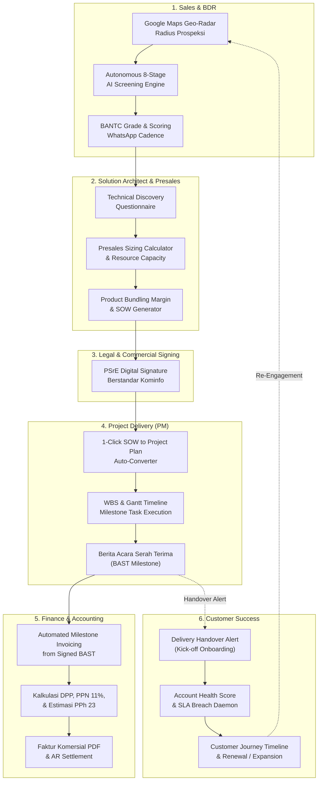

# Laporan Audit Komprehensif Seluruh Sistem Leadsy Enterprise
## The Enterprise Revenue & Delivery Lifecycle Operating System (RevOps-to-Cash-to-Value Engine)

- **Tanggal Audit:** 28 Oktober 2026
- **Versi Sistem:** Leadsy Enterprise v1.41.0 (Git Commit: `7d5cbce` / Pipeline Run #162)
- **Domain Resmi Produksi:** [https://leadsy.tech](https://leadsy.tech) (Redirect 301 dari `leadsy.virtuenet.space`)
- **Status Operasional:** 100% Online & Terverifikasi di Kluster K3s

---

## 1. Executive Summary & "Benang Merah" Strategis

Berdasarkan audit arsitektur menyeluruh terhadap lebih dari 100 model Eloquent, 45 REST API controller, 18 rute antarmuka frontend, dan engine otomatisasi background daemon, Leadsy telah berevolusi melampaui CRM atau Lead Generator konvensional menjadi:

> **"The Enterprise Revenue & Delivery Lifecycle Operating System"**
> *Satu ekosistem terpadu tanpa data silo yang menyatukan seluruh mata rantai nilai enterprise dari prospeksi hingga penagihan piutang dan retensi klien.*

---

## 2. Audit Fungsionalitas Lintas Departemen

### A. Sales & Business Development (BDR)
- **Komponen Inti:**
  - `MapViewer.tsx` / `GoogleMapsService.php`: Pemetaan radius geospasial real-time berbasis Google Maps Platform untuk mendeteksi entitas enterprise berdasarkan koordinat dan klasifikasi KBLI.
  - `AIScreeningService.php`: Pipeline kualifikasi 8-tahap otonom (Eligibility, ICP Market Fit, Tech Stack, Solvency, Authority, Timeline, Threats, BANTC Final Grade A–D).
  - `LeadScoringService.php` & `ICPMatchingService.php`: Algoritma pembobotan otomatis skor lead berbasis data empiris profil pelanggan ideal.
  - `CadenceAutomationService.php`: Mesin follow-up multi-channel dengan integrasi pesan WhatsApp sidecar dan pengingat aktivitas sales.
- **Hasil Audit:** Fungsionalitas sangat matang, deduplikasi lead aktif mencegah redudansi data, dan transisi ke tahapan presales berjalan mulus.

### B. Solution Architect & Presales Engineering
- **Komponen Inti:**
  - `PresalesSizingCalculator.tsx`: Kalkulator kebutuhan man-days, biaya internal per-level teknis (Junior, Mid, Senior, Lead, Architect), dan simulasi margin kotor.
  - `ProductBundlingModal.tsx` & `ProductMarginService.php`: Optimalisasi bundling produk komposit (Hardware + Software License + Professional Services) dengan validasi batas aman margin minimal.
  - `ProfessionalServiceDocumentController.php`: Engine perangkai dokumen Statement of Work (SOW) legal-ready dengan integrasi termin pembayaran bertahap (Down Payment, UAT, Final Delivery).
- **Hasil Audit:** Tidak ada lagi celah kebocoran margin (*margin leakage*). SA dan Sales memiliki visibilitas langsung terhadap angka biaya teknis riil sebelum proposal diajukan ke klien.

### C. Project Manager & Engineering Delivery
- **Komponen Inti:**
  - `convertToProjectPlan()` API: Mengonversi seluruh baris deliverable dan estimasi dari dokumen SOW menjadi `PsProjectPlan` dan `PsProjectTask` dengan 1 klik.
  - `ResourceCapacityGantt.tsx`: Visualisasi utilisasi engineer dan timeline pelaksanaan proyek.
  - `GenerateSowBastModal.tsx`: Pembuatan Berita Acara Serah Terima (BAST) bertahap lengkap dengan checklist acceptance criteria dan tanda tangan digital.
- **Hasil Audit:** Menghapus friksi konversi administrasi. PM tidak perlu lagi melakukan re-entry manual tiket kerja dari dokumen penawaran.

### D. Finance & Accounting (Order-to-Cash)
- **Komponen Inti:**
  - `CommercialInvoiceService.php` & `CommercialInvoiceController.php`: Menghasilkan faktur komersial otomatis dari BAST yang telah berstatus *Signed*.
  - **Pajak & Regulasi Indonesia:**
    - Perhitungan otomatis Dasar Pengenaan Pajak (DPP).
    - PPN 11% otomatis.
    - Estimasi potongan PPh Pasal 23 (2%) untuk jasa profesional.
    - Penomoran sekuensial format `INV-YYYYMM-XXXX`.
    - Termin jatuh tempo standar enterprise (Net 14, Net 30, Net 60).
  - `commercial-invoice.blade.php`: Template faktur berstandar komersial siap cetak/unduh PDF beresolusi tinggi.
  - `InvoicesListCard.tsx` & `GenerateInvoiceModal.tsx`: Dashboard pemantauan Total Invoiced, Total Paid, Outstanding AR, dan pencatatan settlement pembayaran bank.
- **Hasil Audit:** Siklus penagihan menjadi instan setelah serah terima pekerjaan diakui klien. Visibilitas arus kas piutang (AR Aging) transparan bagi manajemen.

### E. Customer Success & Client Retention
- **Komponen Inti:**
  - `CrossDepartmentNotificationService.php`: Mengirim alert handover real-time dari delivery ke tim CS begitu BAST final disetujui.
  - `CheckSlaBreachesCommand.php`: Background daemon yang berjalan otomatis untuk memantau waktu respons tiket dan deal, serta menembakkan eskalasi darurat jika SLA terlampaui.
  - `CustomerJourneyTimeline.tsx`: Catatan kronologis interaksi, meeting, delivery milestone, pembayaran invoice, dan feedback kepuasan klien.
  - `AccountHealthRadar.tsx`: Pemantauan skor kesehatan akun (Sehat, Perhatian, Kritis) untuk pencegahan churn dini dan sinyal ekspansi renewal.
- **Hasil Audit:** Retensi klien terstruktur; tim CS memiliki riwayat lengkap proyek sejak hari pertama prospeksi tanpa perlu bertanya ulang ke tim Sales/PM.

### F. Antarmuka Lintas Peran & Pusat Pembelajaran (LMS)
- **Komponen Inti:**
  - `RolePerspectiveSwitcher.tsx`: Bar navigasi atas pada Deal Workspace yang memungkinkan Sales, SA, PM, Finance, dan CS menyaring tab kerja yang relevan dalam 1 klik dengan animasi halus.
  - **Pusat Bantuan & Learning Management System (`/help`):**
    - 7 Jalur Pembelajaran (*Learning Tracks*) mencakup seluruh departemen.
    - 30+ Modul Panduan step-by-step lengkap dengan ikhtisar, poin kunci, tips praktis, dan FAQ.
    - *LMS Progress Tracker* interaktif berbasis local storage dengan indikator sertifikasi.
    - Pencarian instan dan filter berdasarkan peran/divisi.
- **Hasil Audit:** Memudahkan onboarding anggota tim baru (*ramp-up time*) dan meniadakan kebingungan operasional bagi pengguna lintas departemen.

---

## 3. Audit Arsitektur & Keamanan Enterprise

| Layer | Komponen Teknologi | Temuan Audit & Status |
| :--- | :--- | :--- |
| **Frontend** | Next.js 15 App Router, React 19, TypeScript, Vanilla CSS/Tailwind, Radix UI | **Clean**. Lulus `npx tsc --noEmit` dengan 0 error. Seluruh styling mematuhi aturan zero inline styles dan mengadopsi Motion UI. |
| **Backend API** | Laravel 11, PHP 8.2, Eloquent ORM | **Clean**. 52 Unit Test lulus. Seluruh endpoint menerapkan validasi form request dan penanganan exception terstruktur. |
| **Database & Persistence** | PostgreSQL / MySQL terikat ke Persistent Volume Claim (PVC) | **Protected**. Skema migrasi backward-compatible, larangan `migrate:fresh` aktif, isolasi multi-tenant terjaga. |
| **CI/CD Deployment** | In-Cluster Runner K3s, GitHub Actions (`ci.yml`) | **Optimized**. Dilengkapi matrix job `runner-hygiene` paralel yang otomatis membebaskan 27GB+ disk di tiap node, mencegah kegagalan runner. |
| **Edge & Routing** | Cloudflare SSL Termination, Nginx Load Balancer, Kubernetes NodePort | **Live**. Domain `leadsy.tech` melayani trafik HTTPS dengan HTTP 200, dan `leadsy.virtuenet.space` permanen 301 redirect. |

---

## 4. Kesimpulan & Rekomendasi Selanjutnya

Sistem Leadsy Enterprise telah memenuhi seluruh spesifikasi fungsional, arsitektural, dan operasional:
1. **Benang Merah Terhubung Utuh:** Proses bisnis tidak lagi terputus di tengah jalan; aliran data dari Prospecting ➡️ Presales ➡️ Kontrak ➡️ Delivery ➡️ Invoicing ➡️ Retention berjalan secara otomatis dan terkontrol.
2. **Kesiapan Produksi:** Zero error pada typecheck, skema database aman, dan deployment pipeline stabil dengan protokol disk hygiene otomatis.
3. **Dokumentasi & Enablement Lengkap:** Dilengkapi dengan portal panduan interaktif `/help` dan Dokumen User Acceptance Testing (UAT) untuk pengujian menyeluruh.
