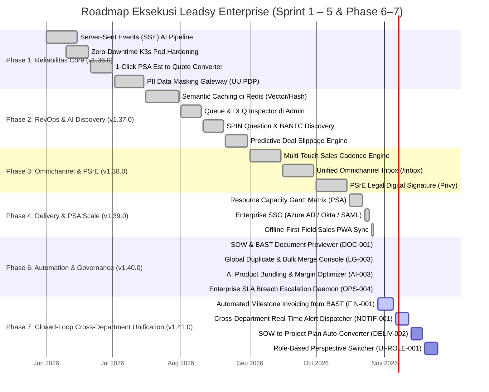

# Rencana Eksekusi & Roadmap Implementasi Leadsy Enterprise (Sprint 1 – 5 & Phase 6–7)

**Dokumen Acuan:** [Laporan Audit Komprehensif Arsitektur Lintas Departemen Leadsy Platform](file:///Users/m61pd0625/.gemini/antigravity-ide/brain/12cd8a2e-6269-4e04-94ab-f88eaae40ba7/leadsy_enterprise_cross_department_audit_report.md)  
**Tujuan Strategis:** Menyatukan seluruh mata rantai kesepakatan B2B (*B2B Deal Lifecycle*) ke dalam **"The Enterprise Revenue & Delivery Lifecycle Operating System (RevOps-to-Cash-to-Value Engine)"** lintas 6 departemen: Solution Architect, Sales/BDR, Project Manager/Delivery, Finance & Accounting, Customer Success, dan Executive/RevOps.  
**Status Realisasi Saat Ini:**  
- **Sprint 1 (Reliabilitas Core & Kepatuhan PDP):** ✅ **SELESAI (100%)** — Commit `338d687` & `e7e8a7e`
- **Sprint 2 (RevOps Velocity & Queue Governance):** ✅ **SELESAI (100%)** — Commit `f4f4165`
- **Sprint 3 (Omnichannel & Autonomous AI):** ✅ **SELESAI (100%)** — Commit `d023697`
- **Sprint 4 (Enterprise Scale & Governance):** ✅ **SELESAI (100%)** — Resource Capacity Gantt Matrix, Enterprise SSO, PSrE Digital Signature, & Offline-First Field Sales Sync
- **Audit Hardening & Governance (v1.34.0 & v1.35.0):** ✅ **SELESAI (100%)** — UI Dialog Governance (Zero `alert`/`confirm`), BelongsToTenant Expansion, Multi-Tenant IDOR Guards & Test Suite, Modularisasi Tabs `leads/[id]`, Worker Liveness Probes
- **Lead Workspace Modularization & Intelligence (v1.38.0 & v1.39.0):** ✅ **SELESAI (100%)** — Modularisasi Workspace Phase 2 & 3, SSE Stream Telemetry, Deduplication Merge Engine, dan AI Next Best Actions.
- **Phase 6: Delivery Governance, RevOps Console & Escalation (v1.40.0):** ✅ **SELESAI (100%)** — SOW/BAST Document Previewer (`DOC-001`), Global Duplicate Console (`LG-003`), AI Product Bundling (`AI-003`), & Enterprise SLA Escalation Daemon (`OPS-004`). Deploy Run `40707103328` (Green).
- **Phase 7: The Closed-Loop Cross-Department Unification (v1.41.0):** 📋 **PLAN READY (MENUNGGU KEPUTUSAN EKSEKUSI)** — BAST-to-Milestone Invoicing (`FIN-001`), Cross-Department Alert Dispatcher (`NOTIF-001`), SOW-to-Project Converter (`DELIV-002`), & Role Workspace Switcher (`UI-ROLE-001`).

---

## 1. Timeline & Phasing Overview

---

## 2. "Benang Merah" & Arsitektur Nilai Lintas Departemen

> [!IMPORTANT]
> **Benang Merah Leadsy:**
> Leadsy bukan sekadar CRM kontak pasif dan bukan sekadar scraper lead. Leadsy adalah **Closed-Loop Enterprise Revenue & Lifecycle Operating System**.
> Setiap lead di Leadsy adalah kontrak hidup, solusi teknis, komitmen jadwal delivery, aliran penagihan kas, dan kemitraan jangka panjang klien.

### Matriks Keterlibatan Lintas Departemen (Cross-Department Value Chain)

| Departemen | Peran Utama di Leadsy | Fitur yang Telah Ada (v1.40.0) | Target Integrasi Fase 7 (v1.41.0) |
| :--- | :--- | :--- | :--- |
| **Sales / BDR** | Akuisisi, Kualifikasi BANTC, Negosiasi | Lead Scraper, ICP Match, Cadence, SPIN Selling, Field PWA | Handover alert otomatis ke Solution Architect saat masuk fase Discovery. |
| **Solution Architect** | Validasi Teknis, Estimasi Mandays, BoQ & Margin | Discovery Workspace, Manday Estimator (`PsEstimation`), AI Bundler (`AI-003`) | Tombol formal "SA Sign-off" sebelum penawaran dikirim ke klien. |
| **Project Manager** | Jadwal Delivery, Kapasitas Tim, Eksekusi BAST | Resource Capacity Gantt, Milestone WBS, BAST Generator (`DOC-001`) | Konversi otomatis deliverable SOW menjadi Project Plan (`DELIV-002`). |
| **Finance & Tax** | Penagihan Termin, Perhitungan PPN/PPh, Realisasi Kas | Lead Quotations, Sales Orders, Tax Codes (PPN 11%, PPh 23) | **Otomasi Pembuatan Invoice dari BAST Signed (`FIN-001`).** |
| **Customer Success** | Onboarding Klien, Skor Kesehatan, Pencegahan Churn | CS Dashboard, Health Score Service, Churn Alert Daemon | Handover otomatis ke CSM begitu BAST Final proyek disetujui. |
| **Executive & RevOps** | Tata Kelola SLA, Kepatuhan Hukum, Deduplikasi Data | SLA Daemon (`OPS-004`), Duplicate Console (`LG-003`), PSrE Privy, SSO | Dispatch notifikasi eskalasi SLA ke Lark & WhatsApp Group (`NOTIF-001`). |

---

## 3. Rincian Eksekusi per Fase Sprint

### 🚀 FASE 1 (Sprint 1) — Reliabilitas Core & Fondasi Keamanan [SELESAI ✅]
- **Deliverables:** Server-Sent Events (SSE) stream, Zero-downtime Pod Hardening K3s, 1-Click PSA to Quote Converter, PII Masking LLM Gateway (UU PDP).

### 📈 FASE 2 (Sprint 2) — RevOps Velocity & Queue Governance [SELESAI ✅]
- **Deliverables:** Semantic Caching Redis (TTL 14 hari), Queue/DLQ Inspector Admin, Predictive Deal Slippage Engine, Automated SOW/BAST Assembler v1.

### 💬 FASE 3 (Sprint 3) — Omnichannel Sales Execution & Autonomous AI [SELESAI ✅]
- **Deliverables:** Multi-touch Sales Cadence Engine, Unified Omnichannel Inbox (`/inbox`), In-context Copilot Drawer, Autonomous AI SDR Scanner.

### 🏢 FASE 4 (Sprint 4) — Enterprise Governance & Skalabilitas Sistem [SELESAI ✅]
- **Deliverables:** Resource Capacity Gantt Matrix (PSA), Enterprise SSO Federation (Azure AD, Okta, SAML 2.0, OIDC), PSrE Legal Digital Signature resmi Kominfo (Privy), Offline-First Field Sales PWA Sync.

### 🏛️ FASE 6 (v1.40.0) — Delivery Governance, RevOps Console & Escalation [SELESAI ✅]
- **Deliverables (Commit `1dbe98f`, Actions Run `40707103328`):**
  - `DOC-001`: Automated SOW & BAST Document Previewer dengan stream download PDF dan integrasi tanda tangan digital PSrE.
  - `LG-003`: Global Duplicate Detection & Bulk Merge Console di tabel lead dan modal RevOps.
  - `AI-003`: AI Smart Product Bundling & Margin Optimizer pada Discovery Workspace.
  - `OPS-004`: Enterprise SLA Breach Daemon (`leadsy:check-sla-breaches`) terjadwal per jam dengan audit trail status.

---

### 🌐 FASE 7 (v1.41.0) — The Closed-Loop Cross-Department Unification [PLAN READY 📋]
**Fokus:** Menghubungkan titik putus terakhir antar departemen — mengotomasi penagihan invoice dari BAST untuk Finance, menyebarkan notifikasi handover real-time ke Lark/WhatsApp, dan mengonversi SOW ke Project Plan.

#### Task 7.1: Automated Milestone Invoicing from Signed BAST (FIN-001)
- **Latar Belakang:** Ketika dokumen BAST ditandatangani via PSrE oleh klien, saat ini tim Finance masih harus menghitung dan mencetak faktur secara manual di luar sistem.
- **Backend Deliverables:**
  - Skema tabel `commercial_invoices` dan `commercial_invoice_items` dengan relasi ke `lead_sales_orders` dan `ps_bast_documents`.
  - Service `CommercialInvoiceService`: Menghitung nilai termin milestone (misal: DP 30%, BAST UAT 50%, BAST Final 20%), kode pajak PPN 11% (`TaxCode`), pemotongan PPh 23, dan tanggal jatuh tempo pembayaran (Terms of Payment 30 hari).
  - Controller `CommercialInvoiceController` dengan endpoint:
    - `POST /api/leads/{lead}/invoices/from-bast/{bastDocument}`: Pembuatan faktur otomatis dari BAST yang sah.
    - `GET /api/invoices/{id}/pdf`: Streaming PDF Faktur Penagihan resmi ber-watermark.
    - `PATCH /api/invoices/{id}/payment-status`: Pencatatan status pembayaran (`unpaid`, `partially_paid`, `paid`).
- **Frontend Deliverables:**
  - Sub-tab *Invoices & Billing* di dalam `RevenueTab.tsx` pada halaman Lead Details.
  - Komponen modal `GenerateInvoiceModal.tsx` dengan pratinjau rincian termin, hitungan PPN 11%, dan tombol cetak/unduh PDF Faktur.
- **Kriteria Selesai (DoD):**
  - Begitu BAST ditandatangani via PSrE, draf faktur langsung siap dalam 1-klik bagi tim Finance tanpa perlu rekalkulasi manual.

#### Task 7.2: Cross-Department Real-Time Alert Dispatcher (NOTIF-001)
- **Latar Belakang:** Peringatan SLA breach dari daemon `OPS-004` dan notifikasi penyelesaian dokumen PSrE saat ini hanya tercatat di database audit trail, belum sampai ke ponsel manajer/tim terkait secara instan.
- **Backend Deliverables:**
  - Service `CrossDepartmentNotificationDispatcher`:
    - Event `BastSignedEvent` ➡️ Kirim Lark Card / WhatsApp alert ke tim Finance: *"BAST Proyek ABC telah ditandatangani klien. Draf Invoice termin 2 siap diterbitkan."*
    - Event `SlaBreachedEvent` ➡️ Kirim alert eskalasi ke Sales Manager & VP Sales saat deal/penawaran macet > 3 hari.
    - Event `SowSignedEvent` ➡️ Kirim alert ke Project Manager: *"SOW Proyek ABC telah sah. Rencana kerja delivery siap diinisialisasi."*
  - Queue Job asynchronous `DispatchLarkInteractiveAlertJob` dan `DispatchWhatsAppAlertJob`.
- **Kriteria Selesai (DoD):**
  - Waktu respon serah terima antar divisi menjadi hitungan menit melalui notifikasi grup chat Lark / WhatsApp yang interaktif.

#### Task 7.3: SOW Deliverables to Project Plan Auto-Converter (DELIV-002)
- **Latar Belakang:** Saat SOW disetujui, PM saat ini harus menyalin ulang deliverable dari dokumen SOW ke tabel jadwal kerja.
- **Backend & Frontend Deliverables:**
  - Endpoint `POST /api/professional-services/sow/{id}/convert-to-project-plan`.
  - Mengonversi butir tugas, estimasi hari kerja (*mandays*), dan role konsultan dari estimasi PSA menjadi entri `PsProjectPlan` dan `PsProjectTask`.
  - Terhubung langsung ke visualisasi `ResourceCapacityGantt.tsx`.
- **Kriteria Selesai (DoD):**
  - PM tidak perlu membuat ulang task proyek dari nol; jadwal kerja langsung terisi sesuai klausul SOW yang disepakati klien.

#### Task 7.4: Role-Based Perspective Switcher on Deal Workspace (UI-ROLE-001)
- **Latar Belakang:** Pengguna dengan peran berbeda (Solution Architect vs Finance vs PM) membutuhkan fokus informasi yang berbeda saat membuka halaman detail lead (`/leads/[id]`).
- **Frontend Deliverables:**
  - Quick-switch selector peran di bagian header lead:
    - Mode **Sales & Commercial:** Menyorot BANTC, SPIN pain points, Quotation, dan Sales Cadence.
    - Mode **Solution Architect:** Menyorot Discovery Workspace, Spesifikasi Teknis, Estimasi PSA, dan Bundling Margin.
    - Mode **Project Delivery:** Menyorot Rencana Kerja, Resource Matrix Gantt, Task WBS, dan BAST.
    - Mode **Finance & Billing:** Menyorot Sales Order, Termin Tagihan, Faktur Invoice, Status Pembayaran, dan Pajak.
- **Kriteria Selesai (DoD):**
  - Setiap departemen dapat menggunakan Leadsy sesuai sudut pandang tugasnya tanpa terdistraksi data divisi lain.

---

## 4. Evaluasi Risiko & Mitigasi

| Risiko Potensial | Tingkat | Rencana Mitigasi |
| :--- | :---: | :--- |
| **Koneksi SSE Terputus pada Jaringan Mobile Lemah** | Sedang | Terapkan auto-reconnect dengan *exponential backoff* dan simpan *last-event-id* agar stream melanjutkan event yang terlewat. |
| **Biaya Token AI Meningkat saat Cadence Otomatis Berjalan** | Sedang | Batasi kuota token harian per tenant melalui *Tenant AI Budget Cap* dan prioritaskan model ringan untuk tugas rutin. |
| **Nomor WhatsApp Terblokir saat Menjalankan Cadence Masif** | Tinggi | Terapkan *smart throttling* (jeda acak 30–90 detik antar pesan) dan gunakan WhatsApp Official BSP untuk outreach skala besar. |
| **Ketidaksesuaian Format Faktur Pajak Standardisasi DJP** | Rendah | Pastikan template invoice komersial mencantumkan kolom NPWP/NIK 16 digit, DPP, dan PPN 11% sesuai format e-Faktur Ditjen Pajak RI. |
