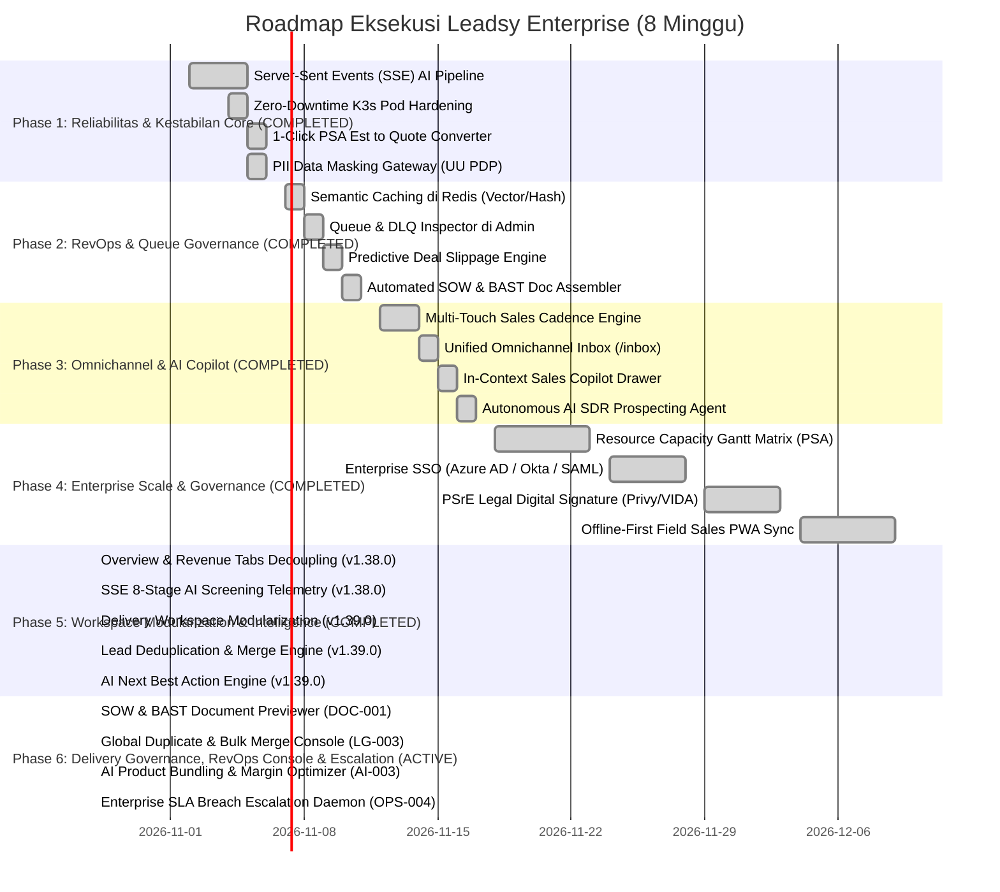

# Rencana Eksekusi & Roadmap Implementasi Leadsy Enterprise (Sprint 1 – 4)

**Dokumen Acuan:** [Laporan Audit Komprehensif Leadsy Platform (v1.31.0)](file:///Users/m61pd0625/Downloads/leadsy_comprehensive_audit_report.pdf)  
**Tujuan Strategis:** Mentransformasi Leadsy dari CRM internal menjadi *Enterprise-Grade Revenue & Presales Operating System* yang andal, scalable, patuh hukum (UU PDP), dan terotomasi secara cerdas.  
**Durasi Total:** 8 Minggu (4 Sprint @ 2 Minggu per Sprint)  
**Status Realisasi Saat Ini:**  
- **Sprint 1 (Reliabilitas Core & Kepatuhan PDP):** ✅ **SELESAI (100%)** — Commit `338d687` & `e7e8a7e`
- **Sprint 2 (RevOps Velocity & Queue Governance):** ✅ **SELESAI (100%)** — Commit `f4f4165`
- **Sprint 3 (Omnichannel & Autonomous AI):** ✅ **SELESAI (100%)** — Commit `d023697`
- **Sprint 4 (Enterprise Scale & Governance):** ✅ **SELESAI (100%)** — Resource Capacity Gantt Matrix, Enterprise SSO, PSrE Digital Signature, & Offline-First Field Sales Sync
- **Audit Hardening & Governance (v1.34.0 & v1.35.0):** ✅ **SELESAI (100%)** — UI Dialog Governance (Zero `alert`/`confirm`), BelongsToTenant Expansion, Multi-Tenant IDOR Guards & Test Suite, Modularisasi Tabs `leads/[id]`, Worker Liveness Probes
- **Lead Workspace Modularization & Intelligence (v1.38.0 & v1.39.0):** ✅ **SELESAI (100%)** — Modularisasi Workspace Phase 2 & 3, SSE Stream Telemetry, Deduplication Merge Engine, dan AI Next Best Actions.
- **Phase 6: Delivery Governance, RevOps Console & Escalation (v1.40.0):** 🔄 **IN PROGRESS** — SOW/BAST Document Previewer, Global Duplicate Console, AI Product Bundling, & Enterprise SLA Escalation Daemon.

---

## 1. Timeline & Phasing Overview



---

## 2. Rincian Eksekusi per Fase Sprint

### 🚀 FASE 1 (Sprint 1) — Reliabilitas Core & Fondasi Keamanan [SELESAI ✅]
**Fokus:** Menghilangkan timeout/error network, memastikan zero-downtime saat deployment, menghubungkan presales ke sales, dan mengamankan privasi data.

#### Task 1.1: Server-Sent Events (SSE) Real-time Stream untuk Pipeline AI
- **Masalah Diselesaikan:** Menghilangkan polling HTTP (interval 2s) yang rentan gateway timeout (502/504) pada reverse proxy/Cloudflare.
- **Backend Deliverables:**
  - Endpoint stream SSE: `GET /api/leads/{id}/ai-screening/stream` dan `GET /api/products/ai-generate/stream/{jobId}` menggunakan Laravel EventStream (`Symfony\Component\HttpFoundation\StreamedResponse`).
  - Broadcast progres tiap stage (misal: `event: stage_started`, `event: stage_completed`, `event: error`).
- **Frontend Deliverables:**
  - Buat hook `useEventSource` di `frontend/lib/hooks/use-event-source.ts`.
  - Update `runAiScreening` di `frontend/lib/aiScreeningPipeline.ts` dan form auto-profile produk di `frontend/app/products/[id]/page.tsx`.
- **Kriteria Selesai (DoD):**
  - AI Screening 9-stage dan Product Scraping berjalan mulus tanpa HTTP polling berulang.
  - Beban request HTTP ke server berkurang >85%.

#### Task 1.2: Zero-Downtime Deployment Pod Hardening di K3s
- **Masalah Diselesaikan:** Menghilangkan respons error *"The server is not responding right now"* saat GitHub Actions melakukan rollout commit baru.
- **DevOps Deliverables:**
  - Update `k8s/leadsy-prod-frontend.yaml` dan backend deployment:
    ```yaml
    lifecycle:
      preStop:
        exec:
          command: ["/bin/sh", "-c", "sleep 15"]
    terminationGracePeriodSeconds: 45
    readinessProbe:
      httpGet:
        path: /api/health
        port: 8000
      initialDelaySeconds: 10
      periodSeconds: 5
    ```
- **Kriteria Selesai (DoD):**
  - Push commit ke branch `main` tidak menghasilkan downtime atau koneksi terputus sama sekali pada browser pengguna yang aktif.

#### Task 1.3: Jembatan 1-Klik Konversi Estimasi PSA ke Quotation Komersial
- **Masalah Diselesaikan:** Menghapus proses manual salin-tempel dari scope teknis presales ke dokumen penawaran harga sales.
- **Deliverables:**
  - Backend: `POST /api/professional-services/estimations/{id}/convert-to-quotation`.
  - Frontend: Tombol aksi *Convert to Quotation* di `/professional-services/estimations/[id]` yang memunculkan modal pratinjau margin dan klausul komersial.
- **Kriteria Selesai (DoD):**
  - Estimasi Man-Days yang disetujui otomatis bertransformasi menjadi line items quotation lengkap dengan rate card dan pajak terhitung.

#### Task 1.4: PII Masking & Sanitizer Gateway untuk LLM (Kepatuhan UU PDP)
- **Masalah Diselesaikan:** Mencegah kebocoran data rahasia klien (NIK, rekening bank, nomor pribadi direksi) ke server LLM pihak ketiga luar negeri.
- **Deliverables:**
  - Middleware / Interceptor pada `AiOrchestrationService` yang melakukan regex anonymization (menyamarkan nama, no telp, email, nomor rekening menjadi token seperti `[PERSON_1]`, `[PHONE_1]`, `[BANK_ACCOUNT_1]`).
  - De-anonymize kembali saat respons LLM diterima sebelum disimpan ke database Leadsy.
- **Kriteria Selesai (DoD):**
  - Payload prompt ke BytePlus/OpenAI bersih dari identitas personal riil tanpa mengurangi akurasi analisis AI.

---

### 📈 FASE 2 (Sprint 2) — RevOps Velocity & Queue Governance [SELESAI ✅]
**Fokus:** Optimasi biaya AI, transparansi antrean background worker, dan kecerdasan prediktif sales deal.

#### Task 2.1: Semantic Caching di Redis untuk Scraping & Profiling
- **Deliverables:**
  - Service `SemanticCacheService` di backend menggunakan hashing URL + nama perusahaan (TTL 14 hari).
  - Melewati pemanggilan AI jika domain yang sama sudah pernah di-profiling dalam 14 hari terakhir kecuali dipicu dengan flag `--force-refresh`.
- **Kriteria Selesai (DoD):**
  - Latensi auto-profiling untuk prospek yang pernah discrape turun dari 25 detik ke < 1 detik.
  - Penghematan konsumsi token BytePlus/OpenAI sebesar 40–60%.

#### Task 2.2: Queue & Dead-Letter Queue (DLQ) Inspector di Admin Console
- **Deliverables:**
  - Halaman monitoring baru di `/admin/infrastructure` sub-tab *Background Jobs*.
  - Menampilkan metrik antrean aktif, job tertunda, dan daftar *Failed Jobs* dengan pesan error trace.
  - Tombol aksi: *Retry Job*, *Retry All Failed*, dan *Purge Stale Cache*.
- **Kriteria Selesai (DoD):**
  - Superadmin dapat mendiagnosis dan memulihkan job AI yang macet dalam 1 klik tanpa akses SSH/terminal server.

#### Task 2.3: Predictive Deal Slippage & Win Probability Engine
- **Deliverables:**
  - Service `DealProbabilityEvaluationService`: Menghitung skor probabilitas menang (0–100%) berdasarkan skor BANTC, deal velocity, dan tren komunikasi.
  - Indikator peringatan dini (*Slippage Warning Badge*) pada papan Kanban Lead Pipeline (`/leads`) untuk deal yang berisiko meleset dari kuartal berjalan.
- **Kriteria Selesai (DoD):**
  - Sales manajer mendapatkan visualisasi instan mengenai pipeline yang sehat vs pipeline yang macet (*at-risk*).

#### Task 2.4: Automated SOW & BAST Document Assembler
- **Deliverables:**
  - Template generator dokumen Word/PDF resmi berstandar perusahaan yang merangkum hasil Discovery Workspace, Man-Days PSA, daftar deliverable, dan klausul hukum BAST.
  - Integrasi tombol *Generate SOW Document* dan *Generate BAST Document*.
- **Kriteria Selesai (DoD):**
  - Dokumen serah terima dan perjanjian kerja siap cetak dan tandatangan dihasilkan otomatis dalam format PDF.

---

### 💬 FASE 3 (Sprint 3) — Omnichannel Sales Execution & Autonomous AI [SELESAI ✅]
**Fokus:** Menyatukan kanal komunikasi sales, mengotomasi follow-up terjadwal, dan menghadirkan asisten AI proaktif.

#### Task 3.1: Multi-Touch Sales Cadence / Sequence Engine
- **Deliverables:**
  - Entitas skema database: `sales_sequences`, `sales_sequence_steps`, `lead_sequence_enrollments`.
  - Mesin eksekusi terjadwal (Scheduler harian) yang memicu langkah outreach:
    - Step 1 (Hari 0): Kirim pesan template WhatsApp personal.
    - Step 2 (Hari 2): Jika tidak ada respon, jadwalkan tugas panggilan telepon BANTC.
    - Step 3 (Hari 5): Kirim email perkenalan profil solusi.
- **Kriteria Selesai (DoD):**
  - Sales rep dapat mendaftarkan lead ke dalam sequence dan sistem mengeksekusi langkah secara otomatis.

#### Task 3.2: Unified Omnichannel Inbox (`/inbox`)
- **Deliverables:**
  - Antarmuka satu pintu di frontend yang menggabungkan percakapan WhatsApp lokal Baileys, akun BSP Qontak, mention Lark, dan email sales.
  - Fitur kolaborasi tim: Catatan internal (*private comments*) antar sales dan manajer pada thread chat yang sama.
- **Kriteria Selesai (DoD):**
  - Tidak ada lagi perpindahan tab/aplikasi untuk membalas prospek; semua komunikasi terekam di riwayat aktivitas lead.

#### Task 3.3: In-Context Sales Copilot Drawer di Lead Details
- **Deliverables:**
  - Komponen *Copilot Sidecar* yang dapat dibuka/tutup di sisi kanan halaman `/leads/[id]`.
  - Berinteraksi langsung dengan model AI yang memegang seluruh memori lead (transkrip rapat, profil perusahaan, kendala teknis discovery).
  - Prompt shortcut instan: *"Buatkan strategi counter objection harga"*, *"Ringkas kebutuhan teknis untuk presales"*, *"Draft pesan WhatsApp tindak lanjut"*.
- **Kriteria Selesai (DoD):**
  - Respons copilot relevan 100% terhadap konteks spesifik lead yang sedang dibuka.

#### Task 3.4: Autonomous AI SDR (Background Prospecting & Signal Ingestion)
- **Deliverables:**
  - Command terjadwal `leadsy:autonomous-prospecting-scan`: Memindai direktori target industri dan kata kunci wilayah tertentu.
  - Ekstraksi sinyal niat beli (berita ekspansi bisnis, pembukaan pabrik, lowongan kerja IT/manajemen).
  - Otomatis memasukkan kandidat lead berpotensi tinggi ke status *Discovery Ingestion* untuk ditinjau oleh tim sales.
- **Kriteria Selesai (DoD):**
  - Prospek baru berkualitas masuk ke pipeline secara otomatis setiap minggu tanpa input manual.

---

### 🏢 FASE 4 (Sprint 4: Minggu 7–8) — Enterprise Governance & Skalabilitas Sistem [SELESAI ✅]
**Fokus:** Kesiapan integrasi korporat skala besar, sertifikasi hukum, dan operasional lapangan offline.

#### Task 4.1: Resource Capacity Gantt Matrix & Skill Tagging (PSA Enterprise) [SELESAI ✅]
- **Deliverables:**
  - Backend: `PsPsaDashboardService::getResourceCapacityMatrix()` & `getSkillMatchRecommendations()`, controller `PsPsaDashboardController@resourceMatrix` & `@recommendStaff`, endpoint `GET /api/professional-services/dashboard/resource-matrix` & `GET /api/professional-services/dashboard/recommend-staff`.
  - Frontend: Komponen `ResourceCapacityGantt.tsx` (visual heatmap mingguan, over-allocated alert > 5.0 MD/minggu, bench availability < 50%) dan `SkillMatchRecommender.tsx` (composite matching score 60% skill fit + 40% availability).
  - Terintegrasi penuh dengan tab switcher di `/professional-services/psa-dashboard`.
- **Kriteria Selesai (DoD):**
  - Mencegah *overallocated* pada arsitek presales dan mengoptimalkan utilitas staf delivery dengan rekomendasi berbasis AI/heuristik.

#### Task 4.2: Enterprise SSO Federation (Microsoft Azure AD / Okta / SAML / OIDC) [SELESAI ✅]
- **Deliverables:**
  - Backend: Skema migrasi `tenant_sso_configs`, Eloquent model `TenantSsoConfig`, service `EnterpriseSsoService` (mendukung SAML 2.0 & OIDC IdP Discovery, metadata parsing, auto-provisioning JIT, role group mapping).
  - API Controller: `EnterpriseSsoController` (`/api/sso/config`, `/api/sso/login`, `/api/sso/saml/acs`, `/api/sso/oidc/callback`, `/api/sso/metadata`).
  - Frontend: Tab pengaturan mandiri `EnterpriseSsoSettings.tsx` terpasang di Security Settings (`/settings/security`), lengkap dengan copyable SP Entity ID & ACS URL.
- **Kriteria Selesai (DoD):**
  - Klien korporat dapat mengelola hak akses karyawan langsung melalui identity provider perusahaan mereka (Azure AD, Okta, PingFederate).

#### Task 4.3: Integrasi Legal Digital Signature Resmi Indonesia (PSrE - PrivyID / VIDA / Peruri) [SELESAI ✅]
- **Deliverables:**
  - Backend: Provider `PrivyPsreProvider.php` terdaftar di `DigitalSignatureManager.php`, mematuhi standar UU ITE 2024 dan akreditasi Kominfo dengan validasi NIK 16 digit dan meterai elektronik (e-Meterai Peruri).
  - Webhook: Endpoint `POST /api/webhooks/digital-signature/{provider}` di `DigitalSignatureController.php` dengan signature hash verification untuk update status dokumen real-time (signed/rejected/expired).
  - Frontend: Pembaruan `send-signature-modal.tsx` dengan opsi penyedia PSrE Berizin Kominfo RI, input NIK penandatangan, dan badge legalitas hukum.
- **Kriteria Selesai (DoD):**
  - Dokumen SPK, SOW, BAST, dan Quotation yang ditandatangani memiliki sertifikat digital berkekuatan hukum penuh pembuktian di pengadilan Indonesia.

#### Task 4.4: Offline-First Field Sales PWA Sync Engine [SELESAI ✅]
- **Deliverables:**
  - Frontend Offline Engine: `offlineSyncManager.ts` dengan queue persistent (`localStorage`), auto-sync saat koneksi online pulih (`navigator.onLine` & `window.addEventListener('online')`), retry throttling, dan toast reporting.
  - UI Status: Indikator visual real-time `OfflineStatusPill` di header aplikasi (`app-shell.tsx`) yang menampilkan jumlah antrean pending dan trigger sinkronisasi instan.
  - Sales Visit Check-in: Komponen `FieldSalesCheckinModal.tsx` di halaman Lead Detail (`/leads/[id]`) dengan deteksi otomatis koordinat GPS (`navigator.geolocation`), geofence reverse lookup, upload foto bukti kunjungan, dan pencatatan catatan meeting offline.
  - Backend: Endpoint `POST /api/leads/{lead}/check-in` di `LeadController.php` untuk menerima payload kunjungan dan menyimpannya sebagai aktivitas timeline terverifikasi.
- **Kriteria Selesai (DoD):**
  - Sales lapangan tetap produktif saat berada di kawasan industri, pabrik, atau area terpencil tanpa hambatan jaringan. Data otomatis tersinkronisasi saat terhubung internet.

---

### 🏛️ FASE 6 (v1.40.0) — Delivery Governance, RevOps Console & Escalation [IN PROGRESS 🔄]
**Fokus:** Penutupan siklus BAST/SOW siap tanda tangan, konsol deduplikasi global, bundling produk presales berbasis AI, dan automasi eskalasi SLA deal.

#### Task 6.1: Automated SOW & BAST Document Previewer & Digital Sign Flow (DOC-001)
- **Deliverables:**
  - Frontend: `GenerateSowBastModal.tsx` di dalam `DeliveryWorkspaceTab` / `ProfessionalServicesTab` dengan pemilihan tipe dokumen (`sow` / `bast`), toggle klausul komersial, in-browser PDF preview, dan tombol integrasi PSrE.
  - Backend: Route & endpoint PDF download / preview stream pada `ProfessionalServiceDocumentController`.
- **Kriteria Selesai (DoD):**
  - Dokumen Berita Acara Serah Terima (BAST) dan Statement of Work (SOW) dapat dihasilkan dan dipratinjau dalam 1-klik sebelum diserahkan ke klien.

#### Task 6.2: Global Duplicate Detection & Bulk Merge Console (LG-003)
- **Deliverables:**
  - Frontend: Tab/Console baru di `/settings/duplicates` dan filter *"Potensi Duplikat"* di tabel utama `/leads`.
  - Backend: Endpoint `GET /api/leads-duplicates/matrix` yang merangkum kelompok lead duplikat di seluruh database dengan agregat skor kecocokan.
- **Kriteria Selesai (DoD):**
  - Admin RevOps dapat memindai dan membersihkan duplikasi data riil di seluruh tenant tanpa perlu membuka lead satu per satu.

#### Task 6.3: AI Smart Product Bundling & Margin Optimizer (AI-003)
- **Deliverables:**
  - Backend: `ProductBundlingRecommendationService.php` yang menganalisis kebutuhan solusi dari BANTC dan menghasilkan rekomendasi paket bundling produk (Hardware + SaaS License + PS) beserta perhitungan simulasi margin.
  - Endpoint: `POST /api/leads/{lead}/recommend-bundles`.
  - Frontend: Komponen `SmartProductBundlingCard.tsx` terintegrasi pada Discovery Workspace.
- **Kriteria Selesai (DoD):**
  - Sales rep mendapatkan rekomendasi kombinasi produk bernilai tinggi beserta perhitungan margin sebelum menyusun penawaran resmi.

#### Task 6.4: Enterprise SLA Breach & Automatic Escalation Daemon (OPS-004)
- **Deliverables:**
  - Backend: Artisan scheduler command `leadsy:check-sla-breaches` terdaftar di `backend/routes/console.php` (setiap jam) yang memeriksa deal yang mengendap melebihi SLA (> 3 hari di draft quotation, > 7 hari tanpa follow-up pada proposal aktif).
  - Notifikasi eskalasi otomatis ke Lark Webhook / WhatsApp internal manajer penjualan.
  - Frontend: Visual warning badge `SLA Breached` pada papan Kanban Lead.
- **Kriteria Selesai (DoD):**
  - Tidak ada deal aktif yang mengendap tanpa tindak lanjut; sistem otomatis memperingatkan pimpinan sales saat SLA terlanggar.

---

## 3. Matriks Alokasi Tim & Kebutuhan Resource

| Peran | Alokasi Beban | Tanggung Jawab Utama |
| :--- | :---: | :--- |
| **Backend Engineer** | 100% | Endpoint SSE, Semantic Caching Redis, Queue & DLQ API, EDA Event Bus, PII Masker, Cadence Engine. |
| **Frontend Engineer** | 100% | SSE Stream consumer, Omnichannel Inbox UI, Copilot Drawer, 1-Click Converter Modal, PWA Offline-Sync. |
| **DevOps / Infra** | 50% | K3s Zero-Downtime Pod Tuning, Redis Vector Setup, Database Table Partitioning, CI/CD Pipeline. |
| **QA / Tester** | 50% | Verifikasi End-to-End, load testing SSE concurrent streams, uji kompatibilitas UU PDP data masking. |

---

## 4. Evaluasi Risiko & Mitigasi

| Risiko Potensial | Tingkat | Rencana Mitigasi |
| :--- | :---: | :--- |
| **Koneksi SSE Terputus pada Jaringan Mobile Lemah** | Sedang | Terapkan auto-reconnect dengan *exponential backoff* dan simpan *last-event-id* agar stream melanjutkan event yang terlewat. |
| **Biaya Token AI Meningkat saat Cadence Otomatis Berjalan** | Sedang | Batasi kuota token harian per tenant melalui *Tenant AI Budget Cap* dan prioritaskan model ringan (Doubao 1.5 Lite / Qwen 2.5) untuk tugas rutin. |
| **Nomor WhatsApp Terblokir saat Menjalankan Cadence Masif** | Tinggi | Terapkan *smart throttling* (jeda acak 30–90 detik antar pesan) dan gunakan WhatsApp Official BSP (Mekari Qontak) untuk outreach skala besar. |
