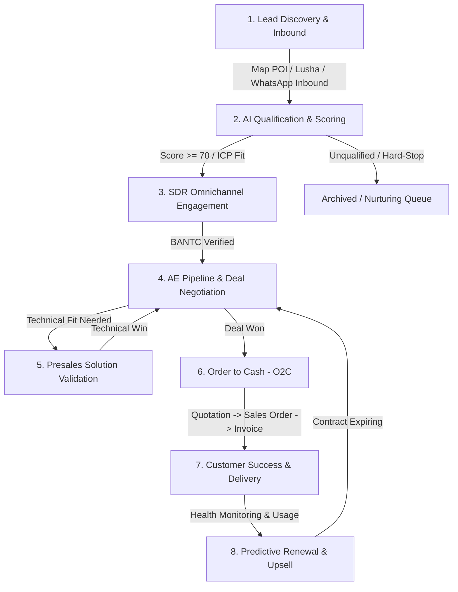

# End-to-End User Process Flow: Leadsy Revenue Ecosystem
**Dokumentasi SOP & Alur Kerja Operasional Platform Leadsy**  
**Versi Dokumen:** v1.2 (Oktober 2026)

---

## 1. Ikhtisar Alur Kerja (Workflow Overview)

Leadsy menghubungkan seluruh siklus pendapatan bisnis (Revenue Lifecycle) dalam satu ekosistem terpadu, mulai dari pencarian prospek teritori di lapangan hingga perpanjangan kontrak pelanggan (Customer Retention).

---

## 2. Rincian Langkah Operasional (Step-by-Step Process)

### Langkah 1: Penemuan Prospek (Lead Discovery & Inbound Intake)
* **Pelaku:** SDR (Sales Development Representative) & Marketing.
* **Metode:**
  1. **Map & Territory Discovery (`/map`):**
     - SDR membuka modul peta, menentukan titik pusat wilayah (dapat menggeser marker pin secara fleksibel), dan memilih radius (misal: 5 km - 25 km).
     - Memilih kategori industri target (misal: Logistik, Manufaktur, Healthcare, Data Center).
     - Menjalankan pencarian; sistem menarik data Google Places API dan menampilkan lokasi prospek di peta.
     - SDR memilih prospek potensial dan mengklik **"Add to Leads Pipeline"**.
  2. **Inbound WhatsApp & Omnichannel (`/inbox`):**
     - Pesan masuk dari WhatsApp resmi (Mekari Qontak) atau nomor lapangan (WhatsApp Baileys).
     - Sistem otomatis mencatat nomor telepon dan membuat kontak di database `whatsapp_conversations`.

---

### Langkah 2: Kualifikasi Cerdas & AI Scoring (AI Qualification Engine)
* **Pelaku:** Autonomous AI SDR Agent & SDR Analyst (`/leads`, `/leads/[id]`).
* **Aktivitas:**
  - Evaluasi otomatis berdasarkan kriteria **BANTC**:
    - **B**udget: Estimasi nilai kontrak dan kemampuan finansial prospek.
    - **A**uthority: Level jabatan pembuat keputusan (C-Level, VP, Direktur).
    - **N**eed: Kebutuhan spesifik otomatisasi atau produk Leadsy.
    - **T**imeline: Target implementasi (Q1 - Q4).
    - **C**ompetitor / Context: Lanskap solusi saat ini.
  - Sistem menghasilkan **Health Score (0 - 100)** dan menetapkan grade kualifikasi:
    - *Grade A / Hot (Score > 80):* Segera ditindaklanjuti.
    - *Grade B / Warm (Score 60 - 79):* Butuh penajaman kebutuhan.
    - *Grade C / Cold (Score < 60):* Masuk ke daftar edukasi berkala.

---

### Langkah 3: Interaksi Terpadu di Omnichannel Inbox (`/inbox`)
* **Pelaku:** SDR & AI Copilot.
* **Aktivitas:**
  - SDR membuka percakapan real-time dengan kontak yang terhubung di database.
  - Memanfaatkan fitur **Saran Balasan AI** (*AI Copilot Suggestions*) untuk merespons pertanyaan teknis dan penawaran harga dengan cepat.
  - Jika lead telah terkonfirmasi siap melakukan demo produk atau pertemuan lanjutan, SDR mengklik tombol **"Jadwalkan Meeting"** atau **"Buka Lead Detail"** untuk mengeskalasi lead ke Account Executive (AE).

---

### Langkah 4: Manajemen Pipeline & Negosiasi Deal (`/leads`, `/dashboard`)
* **Pelaku:** Account Executive (AE).
* **Aktivitas:**
  - Memindahkan tahap lead di visual pipeline (Funnel Stages):
    `Inbound / Discovery` → `Proposal / SOW` → `Negotiation` → `Closed Won`.
  - Mengupdate estimasi deal value dan tanggal perkiraan closing (*expected close date*).
  - Memantau probabilitas kemenangan (*Deal Win Probability*) berbasis AI insight.

---

### Langkah 5: Kolaborasi Solusi Presales (Technical Trust Validation)
* **Pelaku:** Presales Solution Architect & Technical Consultant.
* **Aktivitas:**
  - Melakukan validasi kesesuaian arsitektur (*Integration Fit Score*).
  - Melakukan Proof of Concept (POC) teknis.
  - Memberikan sinyal *Technical Win* untuk memastikan solusi dapat diimplementasikan tanpa hambatan teknis.

---

### Langkah 6: Eksekusi Order to Cash - O2C (`/leads/[id]?tab=order-to-cash`)
* **Pelaku:** AE, Sales Ops, & Finance Team.
* **Aktivitas:**
  1. **Quotation:** Membuat penawaran resmi dengan rincian produk, harga katalog, dan diskon yang disetujui.
  2. **Sales Order (SO):** Mengubah Quotation menjadi Sales Order resmi langsung dari sub-tab Lead Detail.
  3. **Pajak & Ketentuan:** Penerapan Tax Code (PPN 11%) dan Withholding Tax (PPh 23) sesuai master data di `/settings/o2c/*`.
  4. **Invoicing & Status:** Penerbitan Invoice dan tracking status pembayaran (*Unpaid*, *Partially Paid*, *Paid*).
  5. Menandai deal sebagai **Closed Won**, yang otomatis mencatatkan realisasi revenue pada KPI Target di `/dashboard`.

---

### Langkah 7: Monitoring Kesehatan Pelanggan (`/customer-success`)
* **Pelaku:** Customer Success Manager (CSM) & Account Manager (AM).
* **Aktivitas:**
  - Memantau **Customer Health Score Matrix** yang terbagi menjadi 3 status:
    - 🟢 **Healthy:** Klien aktif menggunakan sistem, tiket komplain rendah, pembayaran tepat waktu.
    - 🟡 **Warning:** Terjadi penurunan frekuensi pemakaian atau interaksi menurun dalam 30 hari terakhir.
    - 🔴 **Critical:** Ada tiket eskalasi yang belum tuntas atau keterlambatan pembayaran; membutuhkan intervensi segera.

---

### Langkah 8: Perpanjangan Kontrak & Ekspansi Akun (`/customer-success/renewals`)
* **Pelaku:** CSM & Account Executive (AE).
* **Aktivitas:**
  - Mesin *Renewal Intelligence* secara otomatis mendeteksi kontrak yang akan habis dalam waktu 30, 60, atau 90 hari ke depan.
  - Sistem menampilkan rekomendasi produk pembaruan, riwayat nilai kontrak sebelumnya, dan peluang *upselling/cross-selling*.
  - CSM/AE langsung membuat peluang pembaruan (*Renewal Opportunity*) dengan satu klik, mengarahkan kembali ke alur negosiasi dan O2C tanpa kehilangan konteks riwayat pelanggan.

---

## 3. Matriks Peran & Tanggung Jawab (RACI Matrix)

| Modul Leadsy | SDR | Account Executive | Presales Architect | Finance / Ops | Customer Success | VP / Management |
| :--- | :---: | :---: | :---: | :---: | :---: | :---: |
| **Map & Territory Discovery** | **R** (Responsible) | C (Consulted) | I (Informed) | I | I | A (Accountable) |
| **Omnichannel Inbox & AI SDR** | **R** | C | I | I | C | A |
| **Pipeline & Deal Negotiation** | I | **R** | C | I | I | A |
| **Technical Validation / POC** | I | C | **R** | I | I | A |
| **Order-to-Cash (Quotation/SO)** | I | **R** | I | **R** | I | A |
| **Customer Success & Renewals** | I | C | I | I | **R** | A |
| **Dashboard & Target Revenue** | I | I | I | I | I | **R / A** |
| **Settings & Governance** | I | I | I | I | I | **A (Admin)** |
